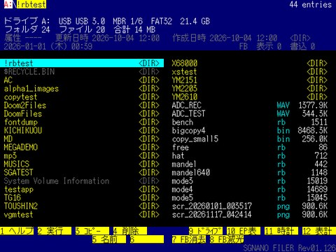
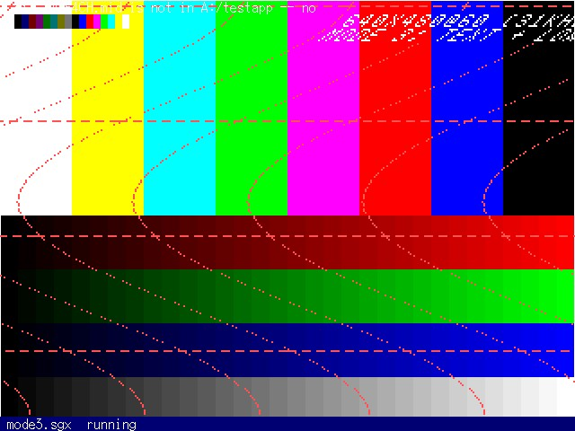
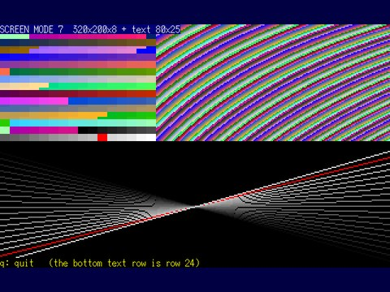
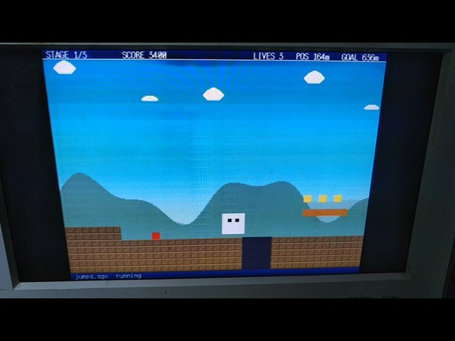
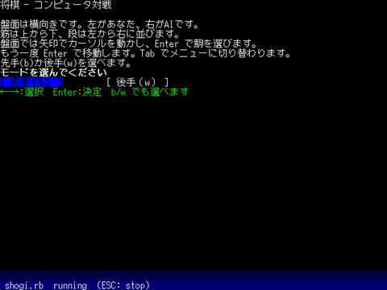
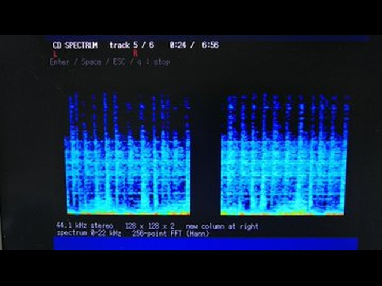
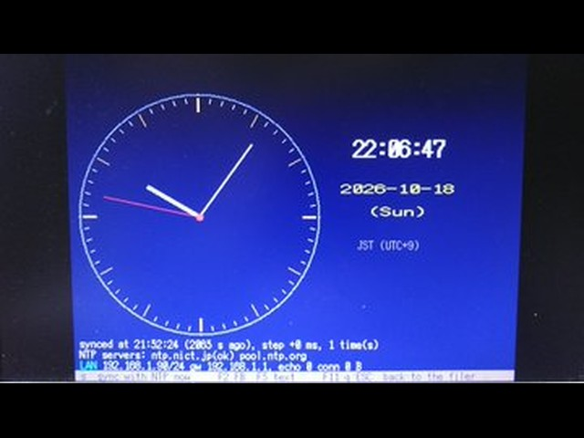
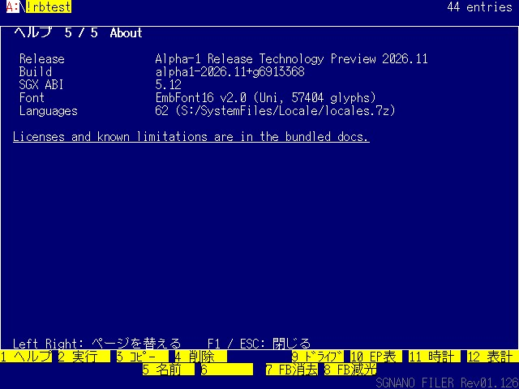

# sgnano

**sgnano**（エスジーナノ）は、RP2350B のチップ 1 つで作る、昔ながらの操作感を持つパーソナルコンピュータです。
アナログ RGB の画面、PT8211 の 4 声ウェーブテーブル音源「Zack」、USB キーボード・マウス・ストレージを備え、
電源を入れるとファイラーが立ち上がり、その場で mruby・MicroPython・SG BASIC のプログラムを書いて走らせられます。

> いまは **α版** です。ファームウェアはバイナリ（UF2）で配り、ソースは整理ができしだい公開します。
> SGX の ABI はまだ凍結していません。α版の間に変わることがあります。文書も順次更新します。

*起動バナー。星は [`sgnano_remote`](https://github.com/antarcticlion/sgnano_remote) のアイコンです。*

## このリポジトリにあるもの

| フォルダ | 中身 |
|---|---|
| `firmware/` | 書き込み用の UF2（準備中。全体・前半のファーム・後半の S: ドライブとフォントの 3 種類を置く予定） |
| `docs/` | 3 言語のコーディングガイド、SGX の ABI、`Machine` の対応表、キー操作の早見表 |
| `samples/` | mruby・MicroPython・SG BASIC の見本（3 言語で同じものがそろったテスト用アプリ、ベンチマーク、デモ） |
| `sdk/sgx/` | C で外部実行ファイル（`.sgx`）を組むための SDK（ABI はα版の間に変わることがあります） |
| `apps/` | SGX の見本（`hello`）。Doom と wav2mp3 のソースは別のリポジトリ（`sgnano_doomgeneric`・`sgnano_wav2mp3`） |
| `hardware/` | C ボードのガーバー |
| `LICENSES/` | ファームウェアと SGX に入っている外部の部品のライセンス文 |

## ハードウェア

- **CPU**: WeAct Studio RP2350B Core Board（Cortex-M33 x 2、302.4MHz で動かす）
- **メモリ**: SRAM 520KB、PSRAM 8MB、フラッシュ 16MB
- **画面**: R・G・B 各 5 ビットの R-2R ラダー DAC。15kHz / 24kHz / 31kHz の 12 通りのタイミング
- **音**: PT8211 x 4（1 チップに 1 声）。オペアンプで混ぜ、カットオフ 150kHz の LPF を通してラインアウトへ
- **入出力**: USB ホスト（フルスピード）、DIN MIDI、GPIO 8 本（PIO2 をユーザーに開放）、ADC

基板（C ボード、100 x 100mm）のガーバーと組み立てガイドは `hardware/c_board/` にあります。手はんだを前提にした高密度の実装です。

- [組み立てガイド（Markdown）](hardware/c_board/ASSEMBLY.md) / [PDF（26 ページ）](hardware/c_board/ASSEMBLY.pdf)
- [部品表（BOM）](hardware/c_board/C_BOARD_BOM.csv) / [配置（1 部品ごと）](hardware/c_board/C_BOARD_PLACEMENT.csv)

*C ボード（100 x 100mm）。RP2350B の Core Board、PT8211 x 4、DIN MIDI、VGA の DAC、GPIO のヘッダ。*

## ソフトウェア

- **ファイラー**: PC-98 の FD に倣った 2 列の一覧。テキストエディタ、日本語 IME、ZMODEM、コピー・移動
- **言語**: mruby 4.0.0、MicroPython 1.29.0、SG BASIC（3 言語の `Machine` は同じメソッドを持つ）
- **シェル**: csh のサブセット sgsh（VT220 の上位互換の端末）
- **外部実行ファイル**: SGX（C で組み、PSRAM に読み込んで RTOS のタスクとして走らせる）
- **画面**: テキスト面（80x30、Unicode、32 ビットの属性）・フレームバッファ（RGB555 / CLUT8 / CLUT4）・ローレゾ面（BG 2 面 + オブジェクト 128 個）
- **音**: 4 声のウェーブテーブル、SMF / SGT のシーケンサー、MP3 / OGG / WAV、VGM / VGZ（YM2151・YM2612・C352 など）

## 画面

実機の画面です（640x480。将棋・jumps・時計・CD は写真）。ほかにも `images/` にあります。

| | |
|---|---|
|  **ファイラー**。PC-98 の FD に倣った 2 列の一覧。 |  **表示の言語は 62**。欧州 34 言語を含みます。 |
|  **画面モード 3**。テキスト + ローレゾ + CLUT8 の FB。 |  **画面モード 7**。320x200x256 のプラズマとテキスト 25 行。 |
|  **jumps**（SGX の見本）。横スクロールのゲーム。 |  **フォントは 57,404 字**。色・線・回転・倍角を 1 画面で。 |
|  **将棋**（mruby の見本）。 |  **SGCALC**。mruby / MicroPython / SG BASIC のマクロ。 |
|  **CD のスペクトログラム**。44.1kHz ステレオ、128x128 を 2 面。 |  **時計**（F11）。NTP で合わせた日本時間。 |
|  **シェル sgsh**。csh のサブセット、組み込みコマンド 70 個。 |  **About**（F1 → → → →）。ビルド ID・ABI・フォント・言語数。 |

## sgnano magazine

α版を外の読者向けに紹介する読み物です（A4 判・10 ページの誌面を想定）。

- [第 1 号　ワンチップに「パソコン」を取り戻せ](docs/magazine/01_alpha_review.md)（2026-11-14）
- [第 2 号　α版、出荷前夜](docs/magazine/02_alpha1_preview.md)（2026-11-17）

## 書き込み

準備中です。UF2 を置いたら、ここに書き込み方を書きます。

## 文書

入口は [`docs/README.md`](docs/README.md) です。

## 関連プロジェクト

### このプロジェクトのリポジトリ

| リポジトリ | 中身 | ライセンス |
|---|---|---|
| [`antarcticlion/sgnano`](https://github.com/antarcticlion/sgnano) | このリポジトリ。ファームのバイナリ（UF2）・文書・見本・SGX の SDK・基板データ | バイナリは無償配布、SDK と見本は MIT、文書は CC BY-SA 4.0、基板は CERN-OHL-P-2.0 |
| [`antarcticlion/EmbFont16`](https://github.com/antarcticlion/EmbFont16) | フォント ROM の形式・ビルダー（v2.0、57,404 字） | MIT（字形は GNU Unifont などのライセンス） |
| [`antarcticlion/sgnano_remote`](https://github.com/antarcticlion/sgnano_remote) | PC からファイルを管理する道具（v0.1.0。**デバッグプローブが必須**。UART の遠隔コマンドと ZMODEM で話す。起動バナーの星はこのアイコン） | MIT |
| [`antarcticlion/sgnano_doomgeneric`](https://github.com/antarcticlion/sgnano_doomgeneric) | Doom（`DOOM.SGX`。doomgeneric と Freedoom） | GPL-2.0 |
| [`antarcticlion/sgnano_wav2mp3`](https://github.com/antarcticlion/sgnano_wav2mp3) | VGM / VGZ を WAV / MP3 に書き出す `wav2mp3.sgx`（LAME） | LGPL-2.0-or-later |
| [`antarcticlion/sgnano_povray`](https://github.com/antarcticlion/sgnano_povray) | POV-Ray 3.7 の `povray.sgx`（ファームにリンクしない独立した SGX） | AGPL-3.0-or-later |

### 使っている外部のソフトウェア

| 部品 | 使い道 | ライセンス | 上流 |
|---|---|---|---|
| mruby 4.0.0 | Ruby | MIT | <https://github.com/mruby/mruby> |
| MicroPython 1.29.0 | Python | MIT | <https://github.com/micropython/micropython> |
| doomgeneric | Doom の本体 | GPL-2.0 | <https://github.com/ozkl/doomgeneric> |
| LAME 3.100 | MP3 の符号化（`wav2mp3`） | LGPL-2.0-or-later | <https://lame.sourceforge.io/> |
| Raspberry Pi Pico SDK 2.2.0 | 土台の SDK | BSD-3-Clause | <https://github.com/raspberrypi/pico-sdk> |
| TinyUSB | USB ホスト | MIT | <https://github.com/hathach/tinyusb> |
| lwIP 2.2 | TCP/IP | BSD-3-Clause | <https://savannah.nongnu.org/projects/lwip/> |
| Mbed TLS 3.6.2 | TLS 1.2・SHA | Apache-2.0 | <https://github.com/Mbed-TLS/mbedtls> |
| ymfm | VGM の FM 音源 | BSD-3-Clause | <https://github.com/aaronsgiles/ymfm> |
| libvgm | VGM の PCM 音源 | BSD-3-Clause | <https://github.com/ValleyBell/libvgm> |
| minimp3 | MP3 の解読 | CC0-1.0 | <https://github.com/lieff/minimp3> |
| stb_vorbis / stb_image | OGG の解読、PNG / JPEG / GIF の解読 | MIT / Public Domain | <https://github.com/nothings/stb> |
| miniz | gzip（VGZ）の展開 | MIT | <https://github.com/richgel999/miniz> |
| libbzip2 1.0.8 | bzip2 | BSD 系 | <https://sourceware.org/bzip2/> |
| LZMA SDK 26.06 | LZMA・xz・7z | Public Domain | <https://7-zip.org/sdk.html> |
| Onigmo 6.2.0 | Ruby の正規表現 | BSD-2-Clause | <https://github.com/k-takata/Onigmo> |
| GNU Unifont | フォントの字形 | SIL OFL 1.1 | <https://unifoundry.com/unifont/> |
| Unicode のデータ（Unihan） | IME の倉頡の表 | Unicode License V3 | <https://www.unicode.org/license.txt> |

全部の一覧とライセンス文は [`LICENSES/README.md`](LICENSES/README.md) にあります。

## 免責事項

sgnano（ファームウェア・SDK・見本・文書・基板のデータを含む）は**「現状のまま」**提供します。
明示か黙示かを問わず、商品性・特定の目的への適合性・権利を侵害していないことを含め、いかなる保証もしません。
sgnano を使ったこと、または使えなかったことによって生じたいかなる損害（データの消失、機器の故障、
ほかの機器・媒体への損害を含む）についても、作者は責任を負いません。

- α版です。ファイルの書き込みを伴う操作の前には、大切なデータのバックアップを取ってください。
- 基板の製作・改造・電源の扱いは、ご自身の責任で行ってください。
- 不具合の報告は歓迎しますが、対応や修正を約束するものではありません。

## ライセンス

詳しくは [`LICENSE`](LICENSE) を見てください。本体のファイラーで表示しているライセンスとクレジットと同じ内容も、そこに載せています。

- ファームウェアは**フリーソフトウェア**（無償で使える。バイナリの配布）として公開します。
- ファームウェアに入っている外部の部品のライセンス文は `LICENSES/` にあります。一覧は [`LICENSES/README.md`](LICENSES/README.md)。
- Doom（GPL-2.0）と wav2mp3（LGPL-2.0-or-later、LAME）のソースとビルドの手順は、別のリポジトリ [`sgnano_doomgeneric`](https://github.com/antarcticlion/sgnano_doomgeneric) と [`sgnano_wav2mp3`](https://github.com/antarcticlion/sgnano_wav2mp3) にあります。
- `samples/` の見本のプログラムは **MIT** です（`samples/LICENSE`。`neon_c/` も MIT）。`samples/sound/WTF4CH.mid` は **CC0** です（`samples/sound/LICENSE`）。
- `sdk/sgx/` は **MIT**、`apps/hello` は **CC0**、`docs/` は **CC BY-SA 4.0**、`hardware/`（ガーバー）は **CERN-OHL-P-2.0** です（それぞれのフォルダの `LICENSE`）。

---

Copyright (c) 2026 antarcticlion（南極獅子）。詳しくは [`LICENSE`](LICENSE) を見てください。
