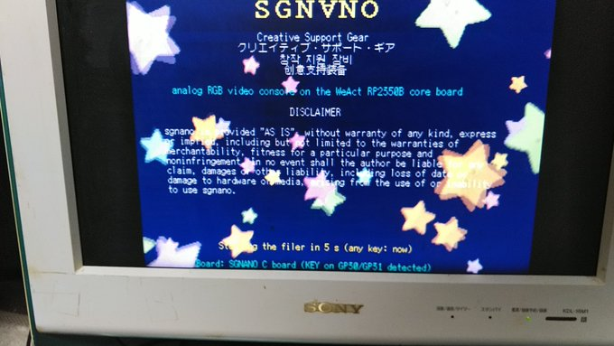
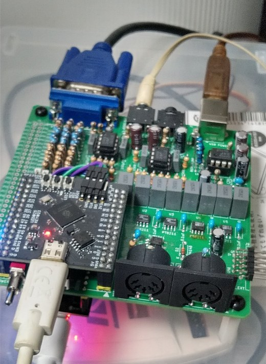
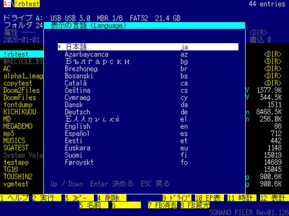
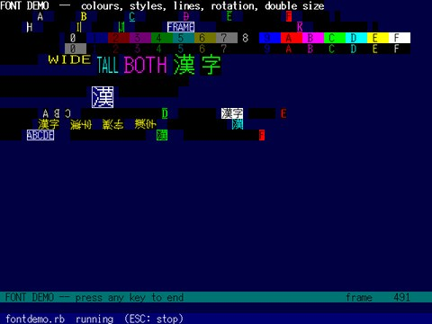
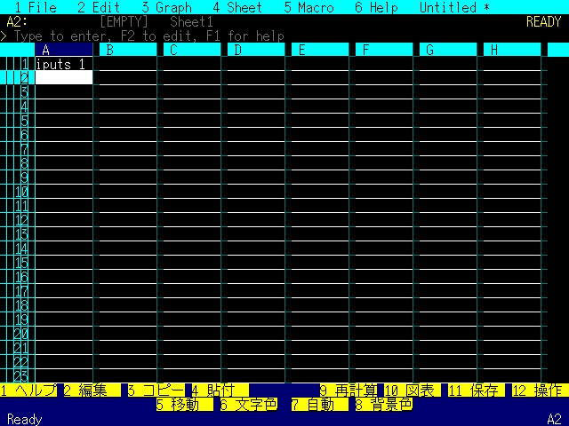
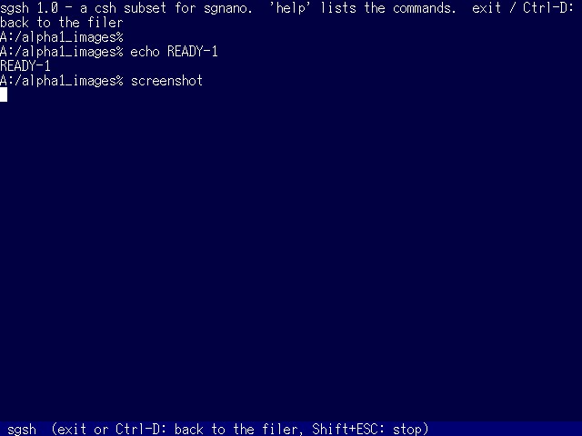

# sgnano

**sgnano**（エスジーナノ）は、RP2350B のチップ 1 つで作る、昔ながらの操作感を持つパーソナルコンピュータです。
アナログ RGB の画面、PT8211 の 4 声ウェーブテーブル音源「Zack」、USB キーボード・マウス・ストレージを備え、
電源を入れるとファイラーが立ち上がり、その場で mruby・MicroPython・SG BASIC のプログラムを書いて走らせられます。

> いまは **α版** です。ファームウェアはバイナリ（UF2）で配り、ソースは後のリリースで公開する予定です。
> SGX の ABI は **5.x を凍結**しています（追加のみ）。文書も順次更新します。

*起動バナー。星は [`sgnano_remote`](https://github.com/antarcticlion/sgnano_remote) のアイコンです。*

## このリポジトリにあるもの

| フォルダ | 中身 |
|---|---|
| `docs/` | 3 言語のコーディングガイド、SGX の ABI、`Machine` の対応表、キー操作の早見表 |
| `samples/` | mruby・MicroPython・SG BASIC の見本（3 言語で同じものがそろったテスト用アプリ、ベンチマーク、デモ） |
| `sdk/sgx/` | C で外部実行ファイル（`.sgx`）を組むための SDK（ABI はα版の間に変わることがあります） |
| `apps/` | SGX の見本（`hello`）と CPU の計測 `cpubench`（α2 から。alpha2-2026.11.2 から 1 コア + 2 コア）。Doom と wav2mp3 のソースは別のリポジトリ（`sgnano_doomgeneric`・`sgnano_wav2mp3`） |
| `hardware/` | C ボードのガーバーと KiCad のプロジェクト（回路図・基板、α2 から） |
| `resources/bench/` | cpubench の負荷の曲（VGZ・MP3、CC BY-SA 4.0） |
| `LICENSES/` | ファームウェアと SGX に入っている外部の部品のライセンス文 |

## ハードウェア

- **CPU**: WeAct Studio RP2350B Core Board（Cortex-M33 x 2、302.4MHz で動かす）
- **メモリ**: SRAM 520KB、PSRAM 8MB、フラッシュ 16MB
- **画面**: R・G・B 各 5 ビットの R-2R ラダー DAC。15kHz / 24kHz / 31kHz の 12 通りのタイミング
- **音**: PT8211 x 4（1 チップに 1 声）。オペアンプで混ぜ、カットオフ 150kHz の LPF を通してラインアウトへ
- **入出力**: USB ホスト（フルスピード）、DIN MIDI、GPIO 8 本（PIO2 をユーザーに開放）、ADC

基板（C ボード、100 x 100mm）のガーバーと組み立てガイドは `hardware/c_board/` にあります。手はんだを前提にした高密度の実装です。

- [組み立てガイド（Markdown）](hardware/c_board/ASSEMBLY.md) / [PDF（26 ページ）](hardware/c_board/ASSEMBLY.pdf)
- [部品表（BOM）](hardware/c_board/C_BOARD_BOM.csv) / [配置（1 部品ごと）](hardware/c_board/C_BOARD_PLACEMENT.csv)

*C ボード（100 x 100mm）。RP2350B の Core Board、PT8211 x 4、DIN MIDI、VGA の DAC、GPIO のヘッダ。*

## ソフトウェア

- **ファイラー**: PC-98 の FD に倣った 2 列の一覧。テキストエディタ、日本語 IME、ZMODEM、コピー・移動
- **言語**: mruby 4.0.0、MicroPython 1.29.0、SG BASIC（3 言語の `Machine` は同じメソッドを持つ）
- **シェル**: csh のサブセット sgsh（VT220 の上位互換の端末）。OS/2 に倣うジョブ制御（`start`・`fg`・`bg`・`suspend`・`ends`・Ctrl-Z）で、同じ言語のプログラムを何本も同時に走らせられる
- **外部実行ファイル**: SGX（C で組み、PSRAM に読み込んで RTOS のタスクとして走らせる）。Core 0 にもサブタスクを起こせる（ABI 5.19）
- **画面**: テキスト面（80x30、Unicode、32 ビットの属性）・フレームバッファ（RGB555 / CLUT8 / CLUT4）・ローレゾ面（BG 2 面 + オブジェクト 128 個）
- **音**: 4 声のウェーブテーブル、SMF / SGT のシーケンサー、MP3 / OGG / WAV、VGM / VGZ（YM2151・YM2612・C352 など）

## 画面

実機の画面です（640x480。将棋・jumps・時計・CD は写真）。ほかにも `images/` にあります。

| | |
|---|---|
|  **ファイラー**。PC-98 の FD に倣った 2 列の一覧。 |  **表示の言語は 62**。欧州 34 言語を含みます。 |
|  **画面モード 3**。テキスト + ローレゾ + CLUT8 の FB。 |  **画面モード 7**。320x200x256 のプラズマとテキスト 25 行。 |
|  **jumps**（SGX の見本）。横スクロールのゲーム。 |  **フォントは 57,404 字**。色・線・回転・倍角を 1 画面で。 |
|  **将棋**（mruby の見本）。 |  **SGCALC**。mruby / MicroPython / SG BASIC のマクロ。 |
|  **CD のスペクトログラム**。44.1kHz ステレオ、128x128 を 2 面。 |  **時計**（F11）。NTP で合わせた日本時間。 |
|  **シェル sgsh**。csh のサブセット、組み込みコマンド 70 個。 |  **About**（F1 → → → →）。ビルド ID・ABI・フォント・言語数。 |

## パッチ 2（alpha2-2026.11.2）で変わったこと

前のパッチ（`alpha2-2026.11.1`、2026-11-23）から **92 のコミット**があり、内部の作りに大きく手が入っています。
新しい機能の多くは、「同じ 1 チップで、より多くを同時に、より滑らかに動かす」ための土台です。詳しくは Release のリリースノートを見てください。

### メモリ: 常駐していたコードを、使うときだけ SRAM に載せる（SRAM +32KB）

RP2350 の SRAM は 520KB しかなく、画面のライン、音、USB、言語の VM がそれを取り合います。これまでは、つながっていない機器のためのコードも
いつも SRAM に置いていました。パッチ 2 では次のコードを **使う間だけ SRAM に写して**走らせ、使い終わったら下ろします。

| まとまり | 載せるとき | 下ろすとき |
|---|---|---|
| ゲームパッド・マウス・ペンタブレット | 機器がつながったとき | 外れて 3 秒たったら |
| 光学ドライブ / FDD・ISO9660 | 光学ドライブ / FDD がつながったとき | 外れて 3 秒たったら |
| ファイラーの一部（一覧の受け口・読み込み・PNG の表示） | ファイラーが動いているとき | プログラムを走らせている間 |

- 何もつないでいないときの SRAM の空きは **173,515 B → 205,671 B（+32KB）** になりました。
- 光学ドライブ / FDD の受け場（4KB）と LAN の送受信の受け場（10.3KB）も、起動のときに取り置かず、機器がつながったときに取ります。
- SRAM が足りないときは、**フラッシュのまま遅く動きます**（止まったり壊れたりはしません）。遠隔コマンド `DYN` で、いまどこにあるかを見られます。

### 音: ドライバーも、鳴らすときだけ SRAM に（SG-9 のモジュール）

FM 音源（YM2151・OPL 系・OPN 系）、MP3 の復号、PCM 系の音源を、**曲が使うものだけ**空いた SRAM に載せるモジュールにしました。
固定の区画は 58KB → 15.9KB に縮み、音を鳴らしていないときの SRAM が大きく空きます。MP3 を鳴らしているときの負荷は **31% → 12%** になりました。
置き場は遠隔コマンド `MODS` で見られます。

### マルチタスク: Core 0 のサブタスクとジョブ制御

- SGX のプログラムが **Core 0 にもタスクを起こせます**（`task_create_core0` / `core_id`、SGX ABI 5.19）。Core 0 は画面を描く合間の空き時間で走らせます。
  3 言語にも `core_id` / `tasks` / `core_stat`。
- シェル sgsh に OS/2 風の **ジョブ制御**（`start`・`detach`・`fg`・`bg`・`suspend`・`ends`、Ctrl-Z）。mruby・MicroPython・SG BASIC のプログラムを何本も同時に走らせられます。

### 画面

- **起動バナー**を作り直しました。流れる星と回る「Ａ」を Core 0 のサブタスクで描くので、Core 1 が忙しくても止まりません。「Ａ」の 4 つのセルが別々のフレームで
  替わるティアリングと、免責の文の後ろの行が欠ける件を直しました。
- モード 2 の FB（2.4MB）を、要るときだけ取るようにしました（`fb_release` / `fb_acquire`、ABI 5.18）。シェルに入ると PSRAM へ返します。壁紙も出せます。
- SGX から 15kHz / 24kHz の画面も開けます（ABI 5.17）。
- ローレゾ面を決まった大きさ（パターン 16KB・パレット 8 本）で開く印 `SGX_MODE_LR_FIXED`（ABI 5.20）。

### 音楽 CD とプレイヤー

- 音楽 CD の再生画面の**文字のちらつきを直しました**。スペクトログラムの範囲は `r` で 1/1 → 1/2 → 1/4。
- `mplay` / `vgmplay` / ファイラーの VGM プレイヤーのスペクトログラムの直し・範囲の切り替え・周波数の目盛り・音量 200%。
- **C64 の SID の曲のプレイヤー `sidplay.sgx`**（新しい。WAV / MP3 への書き出しも）。

### そのほか

- `adcrec.sgx` が止まらなかった件、シェルの前景のプログラムへのキーの渡し方、UART のコンソールの長い行の文字落ち、Ruby のバックグラウンドのジョブを止めたときの
  HardFault などを直しました。JUMPS はパッドの上入力でもジャンプします。プログラムの実行中も画面の写し（Alt+PrintScreen）が撮れます。
- 表示の言語 62 言語の訳を直しました（キーの名前の誤訳など）。
- **SGX ABI は 5.16 → 5.20**。どれも表の末尾に足しただけで、**5.16 以前のプログラムはそのまま動きます**。

## sgnano magazine

α版を外の読者向けに紹介する読み物です。

- [第 1 号　ワンチップに「パソコン」を取り戻せ](docs/magazine/01_alpha_review.md)（2026-11-14、[誌面の PDF](docs/magazine/01_alpha_review.pdf)）
- [第 2 号　α版、出荷前夜](docs/magazine/02_alpha1_preview.md)（2026-11-17、[誌面の PDF](docs/magazine/02_alpha1_preview.pdf)）
- [第 3 号　α2、使ってみた](docs/magazine/03_alpha2_review.md)（2026-11-21、[誌面の PDF](docs/magazine/03_alpha2_review.pdf)）

## ダウンロードと書き込み

**最新リリースは [alpha2-2026.11.2](https://github.com/antarcticlion/sgnano/releases/tag/alpha2-2026.11.2) です。配布物は [Releases](https://github.com/antarcticlion/sgnano/releases) にあります。**

| 何を入れるか | ファイル |
|---|---|
| **最新ファームウェア**（S: とフォントを残して更新） | [alpha2-2026.11.2 の Release](https://github.com/antarcticlion/sgnano/releases/tag/alpha2-2026.11.2) / [ファーム UF2](https://github.com/antarcticlion/sgnano/releases/download/alpha2-2026.11.2/sgnano-alpha2-2026.11.2-firmware.uf2) |
| **S: の更新**（変わったファイル 29 本とインストーラ） | [S: の更新 zip](https://github.com/antarcticlion/sgnano/releases/download/alpha2-2026.11.2/sgnano-alpha2-2026.11.2-s-update.zip) |
| **α2 の一式**（初回。S: とフォントも入る） | [alpha2-2026.11 の Release](https://github.com/antarcticlion/sgnano/releases/tag/alpha2-2026.11) / [全体 UF2](https://github.com/antarcticlion/sgnano/releases/download/alpha2-2026.11/sgnano-alpha2-2026.11-full.uf2) / [IME の辞書](https://github.com/antarcticlion/sgnano/releases/download/alpha1-2026.11/sgnano-alpha1-2026.11-ime-dict.zip)（α1 と同じ） |
| **S: とフォント** | [後半 UF2](https://github.com/antarcticlion/sgnano/releases/download/alpha2-2026.11/sgnano-alpha2-2026.11-system-font.uf2) |

1. **初回**は α2 の全体 UF2 を、BOOTSEL で立ち上げた `RPI-RP2` へコピーします。**S: は初期化されます。**
2. そのあと、**最新ファームウェアの UF2（`alpha2-2026.11.2`）** をコピーします（ファームだけ更新。S: とフォントは残ります）。
3. **α1 や α2 から更新するとき**は、最新ファームウェアの UF2 をコピーしてください（S: とフォントはそのまま残ります）。
4. ファームを書いたら、下の手順で **S: の更新**を入れます（新しいプレイヤー・訳の直しなど。入れなくても新しいファームは動きます）。
5. 日本語の漢字変換には **IME の辞書**（`-ime-dict.zip`）が要ります。USB のドライブのルートに `SgnanoIME/` ごと置いてください（S: の 4MB には入りません）。
6. フォント ROM はファームと同じ版を使ってください。v1 の ROM では文字が出ません。

SHA-256 は各 Release の `SHA256SUMS` にあります。

### S: の更新の入れ方（alpha2-2026.11.2）

S:（内蔵フラッシュのシステムのドライブ、4MB）は空きが少ないので、**インストーラは USB メモリなどの外部のドライブに置いて使います**。
上書きする前のファイルの控えも、外部のドライブに取ります。新しいプログラムは新しいファームでないと読み込めないので、**先にファームを書いてください**。

1. `sgnano-alpha2-2026.11.2-s-update.zip` を PC で展開し、出てきた `sgnano-alpha2-2026.11.2-s-update` フォルダを丸ごと USB メモリ（FAT32・exFAT）に写します。
2. USB メモリを本体につなぎ、ファイラーでそのフォルダに入って **`install.rb` を Enter** で走らせます。
3. インストーラは次の順に進めます。
   1. 更新のファイル（S: のフォルダごとの ZIP）を USB メモリの作業フォルダへ一度展開し、大きさと CRC32 を確かめる。合わなければ何も書かずに止まる
   2. S: の空きが足りるかを確かめる
   3. **Y を押すと入れ始める**（ほかのキーでやめる）
   4. 上書きする S: のファイルを、USB メモリのそのフォルダの `backup/` に控える。控えられなければ S: に触らずに止まる
   5. S: へ入れ、入ったものの CRC32 を照らし合わせる。結果は画面と `S:/SystemLogs/install_alpha2-2026.11.2.txt` に残る
4. 入れている間は ESC を押さないでください。終わったら本体を再起動します（Shift+F12）。

**元に戻すとき**は、同じフォルダの **`restore.rb` を Enter** で走らせます。いちばん新しい控えから書き戻し、更新で新しく入ったファイルは消します。

入るもの（29 本）:

| S: のフォルダ | ファイル |
|---|---|
| `S:/bin/` | `mplay.sgx`・`vgmplay.sgx`（スペクトログラムの直しなど）、`sidplay.sgx`（新しい） |
| `S:/sbin/` | `ps.sgx`（Core 0 のタスクとコアの列） |
| `S:/SystemFiles/Locale/` | `locales.7z`（62 言語の訳の直し） |
| `S:/testapp/` | `adcrec.sgx`・`jumps.*`（5 本）・`stress.sgx`・`mode0`〜`mode6.sgx`・`mode1_vgm`〜`mode6_vgm.sgx`・`mode6_15k.sgx`・`mode6_24k.sgx`（新しい） |

## CPU の計測（cpubench、alpha2-2026.11.2）

[`apps/cpubench`](apps/cpubench/) で、画面モードと音楽の負荷の下で Dhrystone 2.1 と Linpack（n = 100）を測った結果です
（clk_sys 302.4 MHz、1 つ 5 秒、データとスタックは SRAM。2026-11-28、alpha2-2026.11.2）。かっこの中は α2（2026-11-21）の値です。

**1 コア（Core 1）**

| 画面 | 音楽 | DMIPS | 単精度 MFLOPS | 倍精度 MFLOPS | 曲の負荷 |
|---|---|---:|---:|---:|---:|
| モード 0（表示なし） | なし | 419.8（410.9） | 60.50（59.61） | 7.23（7.13） | 0% |
| モード 0 | MP3 | **350.9**（263.3） | **50.41**（39.24） | n/a（4.60） | **12%**（31%） |
| モード 0 | VGM（YM2151 + C352） | 147.9（155.0） | 24.27（24.94） | **2.73**（n/a） | 60%（57%） |
| モード 2（テキスト + RGB555 の FB） | なし | 116.2（116.8） | 16.86（16.95） | 2.00（2.02） | 0% |
| モード 2 | MP3 | **72.6**（2.2） | **10.60**（0.49） | n/a（0.00） | **21%**（111%） |
| モード 5（テキスト + ローレゾ） | なし | 416.1（410.6） | 59.97（59.56） | 7.18（7.15） | 0% |
| モード 6（ローレゾだけ） | MP3 | **347.4**（264.3） | n/a（39.41） | n/a | **12%**（31%） |
| モード 7（テキスト + 320x200 のビットマップ） | なし | **417.9**（358.1） | **60.32**（52.12） | n/a（6.55） | 0% |

**2 コア（Core 1 + Core 0 のサブタスク）**

| 画面 | 音楽 | DMIPS | 単精度 MFLOPS |
|---|---|---:|---:|
| モード 0 | なし | 669.4 | 105.61 |
| モード 6 | なし | 517.1 | 78.49 |
| モード 7 | なし | 611.1 | n/a |

- MP3 の復号が SRAM に載るモジュールになり、MP3 を鳴らしながらの計算が大きく伸びました（FB を出すモード 2 で 2.2 → 72.6 DMIPS）。
- 画面の乱れ（fifo_stall）は、全部の組み合わせで 0 でした（α2 では FB のモードで 2〜38）。
- n/a は、SRAM に必要な連続した空きが無くて測れなかった組み合わせです。MP3 の復号が SRAM を使うぶん、MP3 を鳴らしながらの倍精度は測れなくなりました。
  2 コアの倍精度は 163KB の連続した SRAM が要るので測れません。
- FB を出すモードでは、画面の取得がメモリの帯域を使うぶん遅くなります。

**サウンドフォント（SF2）は入っていません。** ファームの SMF 再生は内蔵の音源（4 声のウェーブテーブル）で鳴るので要りません。
`smf2vgm.sgx`（MIDI → VGM / VGZ）を使うときだけ、[MuseScore_General.sf2](https://ftp.osuosl.org/pub/musescore/soundfont/MuseScore_General/MuseScore_General.sf2)（約 83MB、MIT）を落として、
USB メモリの `<ドライブ>:/SoundFonts/` に置いてください（S: の 4MB には入りません）。`.sf3` は読みません。
変換した VGM / VGZ を配るときは、MuseScore General の著作権表示と MIT の許諾文を添えてください。

## 文書

入口は [`docs/README.md`](docs/README.md) です。

## 関連プロジェクト

### このプロジェクトのリポジトリ

| リポジトリ | 中身 | ライセンス |
|---|---|---|
| [`antarcticlion/sgnano`](https://github.com/antarcticlion/sgnano) | このリポジトリ。ファームのバイナリ（UF2）・文書・見本・SGX の SDK・基板データ | バイナリは無償配布、SDK と見本は MIT、文書は CC BY-SA 4.0、基板は CERN-OHL-P-2.0 |
| [`antarcticlion/EmbFont16`](https://github.com/antarcticlion/EmbFont16) | フォント ROM の形式・ビルダー（v2.0、57,404 字） | MIT（字形は GNU Unifont などのライセンス） |
| [`antarcticlion/sgnano_remote`](https://github.com/antarcticlion/sgnano_remote) | PC からファイルを管理する道具（v0.1.0。**デバッグプローブが必須**。UART の遠隔コマンドと ZMODEM で話す。起動バナーの星はこのアイコン） | MIT |
| [`antarcticlion/sgnano_doomgeneric`](https://github.com/antarcticlion/sgnano_doomgeneric) | Doom（`DOOM.SGX`。doomgeneric と Freedoom） | GPL-2.0 |
| [`antarcticlion/sgnano_wav2mp3`](https://github.com/antarcticlion/sgnano_wav2mp3) | VGM / VGZ を WAV / MP3 に書き出す `wav2mp3.sgx`（LAME） | LGPL-2.0-or-later |
| [`antarcticlion/sgnano_povray`](https://github.com/antarcticlion/sgnano_povray) | POV-Ray 3.7 の `povray.sgx`（ファームにリンクしない独立した SGX） | AGPL-3.0-or-later |

### 使っている外部のソフトウェア

| 部品 | 使い道 | ライセンス | 上流 |
|---|---|---|---|
| mruby 4.0.0 | Ruby | MIT | <https://github.com/mruby/mruby> |
| MicroPython 1.29.0 | Python | MIT | <https://github.com/micropython/micropython> |
| doomgeneric | Doom の本体 | GPL-2.0 | <https://github.com/ozkl/doomgeneric> |
| LAME 3.100 | MP3 の符号化（`wav2mp3`） | LGPL-2.0-or-later | <https://lame.sourceforge.io/> |
| Raspberry Pi Pico SDK 2.2.0 | 土台の SDK | BSD-3-Clause | <https://github.com/raspberrypi/pico-sdk> |
| TinyUSB | USB ホスト | MIT | <https://github.com/hathach/tinyusb> |
| lwIP 2.2 | TCP/IP | BSD-3-Clause | <https://savannah.nongnu.org/projects/lwip/> |
| Mbed TLS 3.6.2 | TLS 1.2・SHA | Apache-2.0 | <https://github.com/Mbed-TLS/mbedtls> |
| ymfm | VGM の FM 音源 | BSD-3-Clause | <https://github.com/aaronsgiles/ymfm> |
| libvgm | VGM の PCM 音源 | BSD-3-Clause | <https://github.com/ValleyBell/libvgm> |
| minimp3 | MP3 の解読 | CC0-1.0 | <https://github.com/lieff/minimp3> |
| stb_vorbis / stb_image | OGG の解読、PNG / JPEG / GIF の解読 | MIT / Public Domain | <https://github.com/nothings/stb> |
| miniz | gzip（VGZ）の展開 | MIT | <https://github.com/richgel999/miniz> |
| libbzip2 1.0.8 | bzip2 | BSD 系 | <https://sourceware.org/bzip2/> |
| LZMA SDK 26.06 | LZMA・xz・7z | Public Domain | <https://7-zip.org/sdk.html> |
| Onigmo 6.2.0 | Ruby の正規表現 | BSD-2-Clause | <https://github.com/k-takata/Onigmo> |
| GNU Unifont | フォントの字形 | SIL OFL 1.1 | <https://unifoundry.com/unifont/> |
| Unicode のデータ（Unihan） | IME の倉頡の表 | Unicode License V3 | <https://www.unicode.org/license.txt> |

全部の一覧とライセンス文は [`LICENSES/README.md`](LICENSES/README.md) にあります。

## 免責事項

sgnano（ファームウェア・SDK・見本・文書・基板のデータを含む）は**「現状のまま」**提供します。
明示か黙示かを問わず、商品性・特定の目的への適合性・権利を侵害していないことを含め、いかなる保証もしません。
sgnano を使ったこと、または使えなかったことによって生じたいかなる損害（データの消失、機器の故障、
ほかの機器・媒体への損害を含む）についても、作者は責任を負いません。

- α版です。ファイルの書き込みを伴う操作の前には、大切なデータのバックアップを取ってください。
- 基板の製作・改造・電源の扱いは、ご自身の責任で行ってください。
- 不具合の報告は歓迎しますが、対応や修正を約束するものではありません。

## ライセンス

詳しくは [`LICENSE`](LICENSE) を見てください。本体のファイラーで表示しているライセンスとクレジットと同じ内容も、そこに載せています。

- ファームウェアは**フリーソフトウェア**（無償で使える。バイナリの配布）として公開します。
- ファームウェアに入っている外部の部品のライセンス文は `LICENSES/` にあります。一覧は [`LICENSES/README.md`](LICENSES/README.md)。
- Doom（GPL-2.0）と wav2mp3（LGPL-2.0-or-later、LAME）のソースとビルドの手順は、別のリポジトリ [`sgnano_doomgeneric`](https://github.com/antarcticlion/sgnano_doomgeneric) と [`sgnano_wav2mp3`](https://github.com/antarcticlion/sgnano_wav2mp3) にあります。
- `samples/` の見本のプログラムは **MIT** です（`samples/LICENSE`。`neon_c/` も MIT）。`samples/sound/WTF4CH.mid` は **CC0** です（`samples/sound/LICENSE`）。
- `sdk/sgx/` は **MIT**、`apps/hello` は **CC0**、`docs/` は **CC BY-SA 4.0**、`hardware/`（ガーバー）は **CERN-OHL-P-2.0** です（それぞれのフォルダの `LICENSE`）。

---

Copyright (c) 2026 antarcticlion（南極獅子）。詳しくは [`LICENSE`](LICENSE) を見てください。
