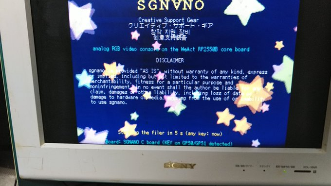
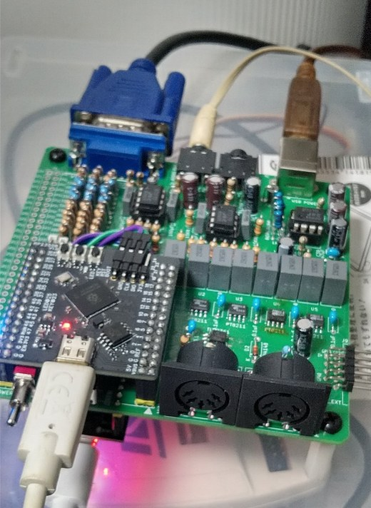
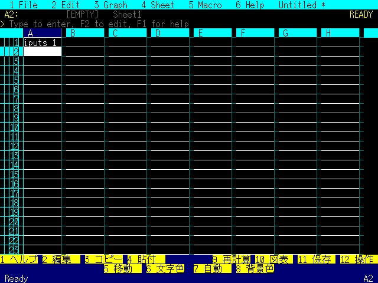
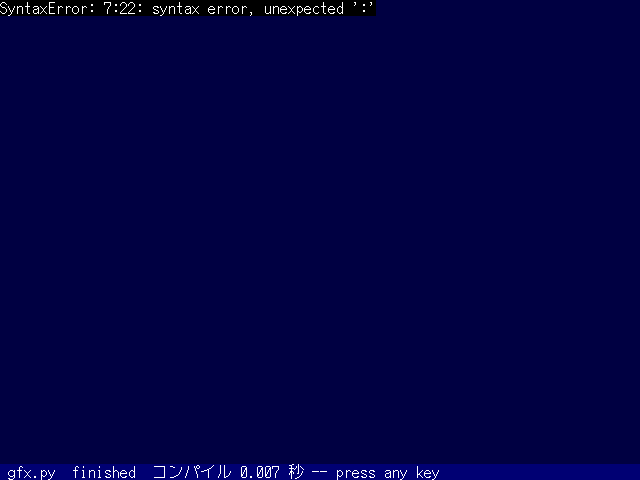

# 特集 第二弾　α版、出荷前夜　――　sgnano「Alpha-1 Release Technology Preview」を検証する

> 前号のレビューから 3 日。コミットは 90 件あまり増え、リリースの ID が付き、UF2 が焼き上がった。
> インラインの IME、コピーレフトなしの 7z。そして新機能の凍結。
> 宿題はどこまで片づいたのか。編集部がもう一度、実機と文書を突き合わせた。

<!--
  誌面の想定: A4 判・10 ページ。「---」1 本を 1 ページの区切りとする。
  数値と事実はリポジトリの記録（リリースノート・既知の制約・関連プロジェクトの表、開発ガイド、git の履歴、images/）と、南極獅子氏への取材（2026-11-17）による。
  前号 = 01_alpha_review.md（2026-11-14）。
-->

---

## p.1　扉　――　3 日で、何が変わったか

前号（11 月 14 日）で編集部は、sgnano のα版を「たいていのことはできるが、そのかわり機械のことをよく知っておけ」と評し、公開の前に片づけてほしい宿題を 5 つ挙げた。

それから 3 日。リポジトリのコミットは 684 から 777 に増えた。ソースは、取り込んだサブプロジェクトを含めて 16 万行を超えた。11 月 17 日、開発は**新機能の凍結**に入り、リリースの名前が決まった。

> **Alpha-1 Release Technology Preview 2026.11**
> リリース ID `alpha1-2026.11`、ビルド ID `alpha1-2026.11+g6913368`、SGX ABI 5.12、フォント EmbFont16 v2.0（57,404 字）

起動するとバナーが 14 秒出る。前半の 7 秒がスペック、後半の 7 秒が英語の免責事項だ。そのあいだ、ローレゾ面のオブジェクトで描いた淡いパステルの星が、くるくる回りながら右上から左下へ流れていく。前号で触れた「ＳＧＮＡＮＯ」の題字の頃より、ずいぶん製品らしい顔つきになった。免責事項を起動の画面に出すあたりに、公開を前にした緊張が見える。



本号では、まず前号の宿題の答え合わせをする。続いて、この 3 日で入った 2 つの目玉（インラインの IME、圧縮と書庫）を詳しく見る。最後に、出荷前夜のα1 になお残る課題を挙げる。

### 本特集の構成

| ページ | 内容 |
|---|---|
| p.2 | 宿題の答え合わせ |
| p.3 | ハードウェア: A4 ステッピングと C ボードの組み立ての手引き |
| p.4 | 目玉その 1: インラインの IME |
| p.5 | 目玉その 2: 圧縮と書庫 |
| p.6 | そのほかの進化 |
| p.7 | 配り方とリポジトリの地図 |
| p.8 | 品質と凍結 |
| p.9 | まだ残る課題 |
| p.10 | 総評 |

---

## p.2　宿題の答え合わせ

前号で挙げた 5 つの宿題が、α1 でどうなったかをまとめる。

| 前号の宿題 | α1 での答え | 判定 |
|---|---|---|
| 1. 起動の確実さ（GP0 のプルアップ）と PSRAM の定格越え | 起動しない問題は A2 ステッピングの RP2350B だけで、C ボードの A4 ステッピングでは出ていない。PSRAM は 151.2MHz のまま、複数の個体で問題なし | ○（ただし文書が古い） |
| 2. USB の推奨構成 | セルフパワーのハブを推奨、と既知の制約に明記。ハブの先の抜き差しの問題は「継続調査」のまま | △ |
| 3. SGX の ABI の凍結 | **ABI 5.12 で 5.x を凍結**。既存の関数・構造体・意味は変えず、追加は末尾だけ | ◎ |
| 4. 翻訳の確認 | 言語は 17 から 62 に増えたが、日本語と英語以外はすべて機械翻訳のまま。協力者を募集中 | △ |
| 5. 入口の文書 | リリースノート、既知の制約、文書の入口（`docs/README.md`）、C ボードの組み立ての手引きがそろった | ○ |

いちばん大きいのは 3 の ABI の凍結だ。前号のインタビューで南極獅子氏は「凍結します」と一言で答えた。その言葉どおり、α1 のリリースノートには「5.x を凍結し、既存の関数・構造体・意味は変えない（追加は末尾だけ）」と書かれている。前号の時点では 8 週間でメジャー版が 5 回変わっていたので、外の人がようやく安心して SGX を書ける段階に来たと言える。

1 については、前号の見立てが半分外れていた。次のページで詳しく見る。

---

## p.3　ハードウェア　――　A4 ステッピングと「組み立ての手引き」

### 問題は古いステッピングだった

前号で「α版を手にする人がまず知っておくべき事実」と書いた、リセット直後にファームが起動しない問題。原因の仮説は、GP0（PSRAM の CS）がプルダウンのまま PSRAM がブート ROM の読み出しに応えてしまう、というものだった。南極獅子氏によると、この問題が出たのは **RP2350B の A2 ステッピング**を載せた基板で、いまの C ボードが使っている **A4 ステッピング**では一度も出ていないという。

**南極獅子**　問題が出たのは A2 ステッピングのものです。C ボードで使用しているのは A4 ステッピングです。何回くらい起動・リセットしたかは覚えていません。

PSRAM の 151.2MHz（定格 133MHz 越え）についても、複数の個体で問題は出ていない。

**南極獅子**　複数の個体でまったく問題が出ていないので、何とも言えません。

編集部としては、長時間の連続運転や温度を変えた試しの数字が欲しいところだ。それでも、手元のすべての個体で問題が出ていないという事実は重い。

ただし、文書がまだ追いついていない。既知の制約の不具合の表とリリースノートには、いまも「リセット直後にごくまれに起動しないことがある（GP0）」「基板の対策待ち」と書かれている。A4 で解決した問題なら、「A2 の基板だけ」と書き直すのが親切だろう。

### C ボードを自分で作れるか

この 3 日で、**C ボードの組み立ての手引き**（`docs/hardware/C_BOARD_ASSEMBLY.md`、PDF 付き）がリポジトリに入った。部品表（BOM）と部品の配置表の CSV、基板の表裏・向きの写真も付いている。本文は 1,100 行を超える。工具、静電気の対策、部品の確かめ、実装の順番、極性の早見表、通電前のチェックまで、パソコン雑誌の製作記事をそのまま本にしたような作りだ。

読んで分かるのは、**難しいのは手はんだの量だけではない**ということだ。

- WeAct の RP2350B Core Board は PSRAM を載せていない版を使い、**裏面に PSRAM（ESP-PSRAM64H、64Mbit = 8MB）を自分で付ける**
- WeAct のボードのユーザースイッチの**プルアップ抵抗を外す**。GP23 を音源のボイス 1 の WS（ワードセレクト）に使うため
- 音を出さない構成（PT8211 を載せない組み方）も選べる

ガーバーは `hardware/` に CERN-OHL-P-2.0 で公開される。頒布について尋ねると、南極獅子氏の答えは次のとおりだった。

**南極獅子**　予定は立てていませんが、何らかの方法で基板や完成品を頒布したいと思います。



> **囲み　C ボードの要点**
>
> | 項目 | 内容 |
> |---|---|
> | 大きさ | 100 × 100mm |
> | CPU | WeAct Studio RP2350B Core Board（A4 ステッピング、PSRAM は自分で裏面に） |
> | 音 | PT8211 × 4、オペアンプ 2 段（LPF のカットオフ 150kHz） |
> | 入出力 | アナログ RGB、ラインアウト、USB-C、DIN MIDI、GPIO A0〜A7、ADC（L/R、バイアス回路つき） |
> | 部品表 | 約 50 行（`docs/hardware/C_BOARD_BOM.csv`） |
> | 基板データ | ガーバー 10 ファイル、CERN-OHL-P-2.0 |

---

## p.4　目玉その 1　――　インラインの IME

### 打った場所で、変換する

南極獅子氏に、この 3 日でいちばんの成果を尋ねると、2 つの答えが返ってきた。インラインの IME と、圧縮と書庫である。

**南極獅子**　インライン IME と圧縮と書庫ですね。エージェントたちがいい仕事をしてくれました。

前号の時点の IME は、画面の下の行で読みを打ち、候補を並べて選ぶ形だった。いまは**打った場所にそのまま未確定の文字が出る**。PC の IME と同じ「インライン」の入力だ。

- 打っているあいだに、文を文節に区切っていく。区切りは、文節の最後の字の**右の枠線**で示す（テキスト面の線の属性を使っている）
- Space を押すと、変換の行が黄色の背景で 1 フレーム光り、文節ごとに変換される。打ちながら区切ってあるので、変換はほとんど一瞬で終わる
- 候補は、変換している行のすぐ下（画面の下の 1/3 なら上）に、**5 個と「→→→」**の小さな窓で出る。「→→→」を選ぶと、**2 列 × 8 個**の大きな窓で全部の候補を見られる
- Enter は途中の文節なら次の文節へ進み、最後の文節で全体を確定する
- **Shift+← / →** で、選んでいる文節をかな 1 字ずつ縮めたり伸ばしたりできる

### 学習する辞書

辞書は、国立国語研究所の UniDic と NAIST-jdic から作った 8.8MiB のファイルだ（どちらも BSD 系のライセンスを選んで使っている）。読みごとの漢字の語を 16・12・8 個まで収めている。S: の 4MB には入らないので、α1 では別の zip（`sgnano-alpha1-2026.11-ime-dict.zip`、4.1MB）で配る。USB のドライブに `SgnanoIME/` のフォルダごと置けば、つないだドライブを全部探して見つける。

学習も気が利いている。選んだ語は 1 回で次から先頭に出る。続けて選んだ 2 つの文節（「校長」と「先生」）は、つないだ語（「校長先生」）としてユーザー辞書に覚える。日本語キーボードの半角 / 全角キーで IME を切り替えられ、半角カタカナに加えて、フォント ROM の私用領域に置いた半角ひらがなまで打てる。

### どこでも使える

この IME は、ファイラーの名前の欄、テキストエディタ、ビュアーの検索に加えて、**シェルの行の編集、Ruby と MicroPython の REPL、SGCALC のセル**でも使える（SGX ABI 5.9 の IME の口）。ターミナルの中で漢字を変換できる 8 ビット機を、編集部は知らない。

> **囲み　IME を作る苦労**
> 開発の記録には、IME まわりの手直しが何度も出てくる。小さな置き場を 1 つずつ取っていて、アプリの作業領域の数の上限（96）を使い切った。exFAT のドライブの辞書を開くとき、ファイルシステムを進める処理が回らずに 30 秒の時間切れになった。変換に 6〜7 秒かかってウォッチドッグで再起動した……。いまは、IME 専用の 256KB の塊を PSRAM に持ち、辞書を引いているあいだは監督のタスクがウォッチドッグを 30 秒まで撫でる。

---

## p.5　目玉その 2　――　圧縮と書庫

### コピーレフトを避けて、7z まで

2 つ目の目玉は、**圧縮と書庫**だ。gzip・zlib・生の deflate、bzip2、LZMA・xz、そして ZIP・7z・tar（.tar.gz / .tar.bz2 / .tar.xz）を、ファームウェアに組み込んだ。

部品の選び方に、南極獅子氏のこだわりが出ている。**コピーレフトの部品は使わない**、という方針だ。

| 形式 | 部品 | ライセンス |
|---|---|---|
| gzip / zlib / deflate | miniz | MIT |
| bzip2 | libbzip2 1.0.8 | BSD 系 |
| LZMA / xz / 7z | LZMA SDK 26.06 | パブリックドメイン |
| tar / ZIP | 自前 | — |

tar は ustar（長い名前は pax / GNU の形）、ZIP は無圧縮・deflate・bzip2・LZMA と ZIP64・UTF-8 の名前に対応する。7z は、LZMA / LZMA2 / 無圧縮なら流しながら読み、BCJ などのフィルタつきはブロックを PSRAM に置いて読む。作るほうは LZMA のソリッドの 1 ブロックだ。PC の 7-Zip が既定の設定（LZMA2、辞書 16MB、BCJ）で作った書庫も、中身がメモリに入れば展開できる。xz は、末尾の目次からブロックの大きさを読んで、伸張の辞書をその大きさまで縮める。小さなマシンで PC 生まれの書庫を開くための工夫だ。

### メモリとの付き合い方

ここでも、主役はメモリのやりくりである。

- 作業場は PSRAM に取る。入らなければ圧縮の段を下げる（LZMA の段 0〜4 は辞書の 8 倍 + 1MB、5〜9 は 12 倍 + 1.2MB）
- PSRAM のふつうの空きで足りなければ、**FB の 4 ページ（2.4MB）を借りる**（FB を表示していないときだけ。返すときは 0 で消す）
- 書き出しは、まず PSRAM に貯める。入らなければ 2 回とおす（1 回目で大きさを数え、その大きさのファイルを作って、2 回目にその場へ書く）
- 圧縮の仕事は専用のタスク（PSRAM のスタック 64KB）で回す。bzip2 や deflate の表の組み立ては、1 関数で 5KB 余りのスタックを使うからだ
- CRC の表はフラッシュに置く。LZMA SDK の CRC は SRAM に 36KB の表を作るので、使わない

### どこからでも

シェルには `gzip` `gunzip` `bzip2` `bunzip2` `xz` `unxz` `lzma` `unlzma` `zip` `unzip` `7z` `tar` の 12 個のコマンドが加わり、組み込みのコマンドは 70 個になった。ファイラーでは、書庫を Enter で開くと中を見る窓が出る。コンテキストメニューからは、印を付けたファイルを zip・7z・tar.gz・tar.bz2・tar.xz にまとめられる。3 つの言語には `Machine::Archive`、SGX には ABI 5.12 の `arc_*` の口がある。

ファームの中でも使われている。表示の言語ファイルは 62 言語ぶん（4.39MB）を 1 つの 7z（829KB）にまとめて S: に置き、選んだ言語だけを平文に展開する。書庫の機能が、そのまま S: の 4MB の節約になっている。

```
% tar czf backup.tgz samples
% 7z l locales.7z
% unzip -l A:/download/archive.zip
```

---

## p.6　そのほかの進化

2 つの目玉のほかにも、この 3 日で多くのものが入った。主なものを挙げる。

| 分野 | 中身 |
|---|---|
| 表示の言語 | 17 から **62** へ（欧州・EU の 34 言語を足した）。選ぶと「読んでいます...」の窓を出し、切り替わったら設定の初めへ戻る |
| フォント | **EmbFont16 v2.0**（旧名 EmbUniFont）。ROM の形式を v2 に改めた。v1 の ROM ではファームの文字が出ない |
| SGCALC | 表計算に**マクロ**。セルに `#!ruby` / `#!python` / `#!basic` と書くと、その言語でシートを動かせる（ABI 5.10） |
| 音 | PSRAM に入らない大きな VGZ も、ファイルから 4KB のページで引いて WAV / MP3 に書き出せる。長い書き出しは進み具合の窓を出す（ABI 5.11） |
| ストレージ | **ドライブ文字の固定**（VID:PID・シリアル・区画の番号で見分ける）。分割ファイルの結合は 64 個から 999 個へ |
| 時計 | ハードの RTC が無いので、**時刻を S: に残す**（15 分ごと、2 つのファイルに交互に書き足す。フラッシュを消さない） |
| USB | USB MIDI の機器（KORG）で、ノートオン・オフ・コントロールチェンジ・ピッチベンドを読めることを確かめた |
| 鍵盤 | 日本語キーボードの半角 / 全角キーで IME を切り替える |

SGCALC のマクロは、前号で褒めた「3 つの言語の `Machine` は同じメソッドを持つ」という決まりが、ここでも効いた例だ。同じ `Sheet` のオブジェクトを、Ruby でも Python でも BASIC でも触れる。



> **囲み　サブプロジェクトの取り込みと切り離し**
> この 3 日で、リポジトリの形も変わった。IME（sgnanoime）と音のデコーダ（sgnano-audio）は外のリポジトリから**本体に取り込み**、以後は本体で管理する。逆に、GPL の Doom と、LGPL の LAME を静的にリンクする wav2mp3 は、**別のリポジトリに切り離した**。コピーレフトのものを本体の外へ、そうでないものを本体の中へ、という整理だ。SGX の SDK の写しを切り離したリポジトリにも置き、それぞれが単体で組めるようにしてある。

---

## p.7　配り方とリポジトリの地図

### 配布物

α1 の配布物は、前号のインタビューで南極獅子氏が語ったとおり、UF2 が 3 種類だ。これに IME の辞書の zip が加わった。

| ファイル | 中身 | 使いどころ |
|---|---|---|
| `-full.uf2` | 16MB 全体（ファーム + S: の初期値 + フォント ROM） | 初回・初期化（S: は消える） |
| `-firmware.uf2` | 前半 8MB（ファームだけ） | 更新（S: とフォントは残る） |
| `-system-font.uf2` | 後半 8MB（S: の初期値 + フォント ROM） | S: とフォントの入れ直し |
| `-ime-dict.zip` | IME の辞書（R01.007）・NOTICE・ライセンス | 日本語の漢字変換に |

どのファイルにも SHA-256 のハッシュが付き、版・ビルド ID・コミット・部品を書いた `manifest.json` が添えられる。S: の初期値は、時刻のファイルも学習のデータも入っていない、まっさらな状態だ。前号で「実機の設定が入った写しは公開に使えない」と心配した点も、きちんと片づいている。

### リポジトリの地図

本体のほかのリポジトリは、**すべて公開済み**だという。

**南極獅子**　すべて公開済みです。あとは本体だけ。

| リポジトリ | 中身 | ライセンス |
|---|---|---|
| sgnano（公開待ち） | UF2、文書、SDK、見本、`apps/hello`、ガーバー | ファームはフリーソフトウェア（バイナリ）、SDK・見本は MIT、`apps/hello` は CC0、文書は CC BY-SA 4.0、基板は CERN-OHL-P-2.0 |
| EmbFont16 | フォント ROM の作り方と読み手 | MIT（フォントは各ライセンス） |
| sgnano_remote | PC からファイルを管理する道具（Qt） | MIT |
| sgnano_doomgeneric | Doom の SGX | GPL-2.0 |
| sgnano_wav2mp3 | WAV → MP3 の SGX（LAME） | LGPL |

POV-Ray の移植は、AGPL-3.0 なので独立したリポジトリで後日公開する予定だという。ファームのソースは α1 には入らず、後のリリースで MIT で公開する予定になっている。

ライセンスの表記の作り込みは、前号のあとに編集部も驚いた点だ。本体のファイラーのライセンスの画面には、ファームに組み込んだ部品（Pico SDK・TinyUSB・lwIP・Mbed TLS・newlib・mruby・MicroPython・Onigmo・LZMA SDK・libbzip2・フォントの OFL の全文など）のライセンスの全文が並ぶ。公開用の `LICENSE` ファイルにも、同じ中身がそのまま載る。

---

## p.8　品質と凍結

### 数字で見る品質

リリースノートの「試験」の節は、個人の趣味のプロジェクトとしては異例の厚さだ。

| 項目 | 結果（2026-11-17） |
|---|---|
| ホスト試験 | `scripts/test_all.sh` の **50 本すべて OK** |
| 静的解析 | cppcheck の指摘 189 件を解消、**warning 0** |
| 実機の起動試験 | テストのプログラム 92 本のうち **90 本**が起動（落ちる 2 本は既知） |
| 負荷試験 | 描画と読み書きを並行させる `stress_sgx.sh` が PASS |
| 起動の確認 | 全体の UF2 を書いた実機で、版・ビルド ID・ABI・フォントの行を確かめた |
| 画面 | α1 の実機で 47 枚を撮影（`images/`） |

試験の数は、前号の「30 本を越える」から 50 本に増えた。ドライブ文字の固定の表、S: に時刻を残す部品、書庫、取り込んだ IME と音のデコーダにも、それぞれホストの試験が付いた。

### 凍結という決断

11 月 17 日から、リリースまで**新機能の追加を凍結**した。凍結のあとにやるのは、不具合の修正・文書・試し・片づけだけだ（表示言語の追加だけは、南極獅子氏の指示で例外的に入った）。足りないものは、既知の制約と積み残しに書き残していく。

前号で編集部は「8 週間でメジャー版が 5 回変わった」ことを心配した。機能を足し続けられる人ほど、止めるのは難しい。それを自分で止めた決断は、リリースの品質を何よりよく物語っている。

### 「エージェントたち」

前号のインタビューで、南極獅子氏は実装を AI のコーディングエージェントに任せたと語った。今回の言葉は「エージェントたちがいい仕事をしてくれました」。複数形である。

開発の記録を見ると、この 3 日のあいだ、IME・書庫・リリースの準備・静的解析・写真の撮影などを、複数のエージェントが並行して進めていたことが分かる。ひとつのエージェントのコミットを待ってから別のエージェントがコミットする、といった段取りまで記録に残っている。人間が方向を決め、何体ものエージェントが手を動かす。8 ビット機の時代には想像もできなかった開発の形だ。

---

## p.9　まだ残る課題

公平のために、α1 に残る課題も挙げておく。どれも既知の制約に書かれていて、隠されていない。

### 既知の不具合

- **一覧で `Shift+F1`〜`Shift+F12` が効かない**。フォルダの削除・作成、シェル、トラッカーなどは、文字のキー（`D` `K` `H` など）で代わりに使える。原因は分かっていて、α2 で直す
- **MicroPython の見本の `fontdemo.py` と `gfx.py` が実機で動かない**（同じ中身の `.rb` と `.bas` は動く）
- Ruby・Python・SGX の**実行中は画面を写せない**
- 起動試験の 92 本のうち `mode7.rb` と `qq3.bas` の 2 本が起動しない
- 同じ exFAT の中の 4MB 級のコピーが read error になることがある

南極獅子氏によれば、これらは**公開までには直らず、α2 で直す**。α版としては妥当な判断だ。直らないものを直ったことにせず、回避策と一緒に書いて出す。その姿勢は、前号から一貫している。

**南極獅子**　公開までに直りません。α2 までに直します。



### 文書と実態のずれ

この 3 日の速さに、文書が追いついていないところもある。

- 前のページで触れたとおり、GP0 の問題は A4 では出ていないのに、既知の制約は「基板の対策待ち」のまま
- 既知の制約には「日本語・英語以外の **15** 言語は仮訳」とある。いまは 62 言語なので、仮訳は 60 言語ぶんになった

どれも公開の前の見直しで片づくものだが、外の人が最初に読む文書なので、ここは丁寧に詰めてほしい。

### 変わらない構造の制約

USB のハブの先での抜き差し（継続調査）、エンドポイント 15 本というハードの上限、PSRAM の定格越え、ハードの RTC が無いこと、USB のデバイスになれないこと（PC から sgnano のドライブは見えない）。これらは RP2350 という 1 チップを選んだことの裏返しで、α版のうちに変わるものではない。

---

## p.10　総評　――　出荷前夜の評価

### 評価の比較

| 項目 | 前号（11/14） | 今号（11/17） | ひとこと |
|---|---|---|---|
| 映像 | ★★★★★ | ★★★★★ | 変わらず。起動のバナーの星は余裕の表れ |
| 音 | ★★★★☆ | ★★★★☆ | 大きな曲の書き出しが通るようになった。4 声と SRAM の制約は残る |
| USB | ★★★☆☆ | ★★★☆☆ | MIDI の機器を確かめた。ハブの先の抜き差しは継続調査 |
| ストレージ | ★★★★☆ | ★★★★★ | 書庫・ドライブ文字の固定・999 個の結合。足りないのは PC との直結だけ |
| 操作系 | ★★★★★ | ★★★★☆ | インラインの IME は大きな前進。ただし Shift+F の不具合で一歩下げた |
| 開発環境 | ★★★★☆ | ★★★★★ | ABI の凍結で、外の人が書き始められるようになった |
| 文書 | ★★★★☆ | ★★★★☆ | リリースノートと組み立ての手引きは見事。実態とのずれが少し残る |
| 安定性 | ★★★☆☆ | ★★★★☆ | A4 では起動の問題が出ていない。数字の裏付けがもう少し欲しい |

### むすび

3 日前、編集部は「α版を外の人の手に渡すには、片づけるか、少なくとも明示してほしい」と 5 つの宿題を出した。α1 は、そのほとんどに答えを出してきた。ABI は凍結され、文書はそろい、起動の問題は古いステッピングのものと分かった。答えの出ていないもの（翻訳の確認、USB のハブ、既知の不具合）は、隠さずに書いて出す。

そして何より、凍結の直前に入った 2 つの機能が、この機械の性格をよく表している。打った場所で漢字に変わる IME と、PC で作った 7z をそのまま開ける書庫だ。どちらも派手なデモではなく、毎日の作業を少しだけ楽にする機能である。「作り手と使い手の土俵を近づける」と前号で語った南極獅子氏の考えは、凍結の直前まで変わらなかった。

あとは、本体のリポジトリの公開を待つばかりだ。基板が頒布されれば、読者の机の上でも、あの回る星が流れる日が来る。編集部はそれを楽しみにしている。

---

> **sgnano Alpha-1 Release Technology Preview 2026.11（リリース直前の版で評価）**
> リリース ID: `alpha1-2026.11`　ビルド ID: `alpha1-2026.11+g6913368`
> 構成: WeAct Studio RP2350B Core Board（A4 ステッピング）+ C ボード（PT8211 × 4・PSRAM 8MB）
> ソフト: ファイラー、M33BEATOS、mruby 4.0.0、MicroPython 1.29.0、SG BASIC R03.001、SGX ABI 5.12（5.x 凍結）、EmbFont16 v2.0、表示の言語 62
> 配布: UF2 × 3 + IME の辞書。ファームはフリーソフトウェア（バイナリ）、ソースは後のリリースで MIT の予定
> 価格: 個人のプロジェクトにつき設定なし（基板・完成品の頒布は検討中）

---

**sgnano magazine**　[第 1 号](01_alpha_review.md) / [第 2 号](02_alpha1_preview.md) / [ダウンロード（Releases）](https://github.com/antarcticlion/sgnano/releases/latest)
