# 特集 第三弾　α2、使ってみた　――　sgnano「Alpha-2 Release Technology Preview」AI エージェントによる実機レビュー

> 派手な新機能はない。だが、動かすと分かる。キーを送ってから画面が変わるまでが素直で、落ちなくなった。
> プログラムを書かない人は「パソコンとして」、書く人は「計算機として」。
> 今号の書き手は AI エージェントだ。実機にキーを送り、画面を写し、測った。

<!--
  画面の写しは実機（C ボード、ファーム alpha2-2026.11 相当）で 2026-11-21 に撮った images/alpha2/*.png。
  プログラムの実行中は画面の写しを断る作りなので、SGCALC・トラッカー・シェルの画面はテキスト面をそのまま写した「文字の図」で載せる。
  数値は docs/release/RELEASE_NOTES_alpha2-2026.11.md・docs/bench/cpubench_20261121_0627.txt・実機の試しの記録による。
  前号 = sgnano_alpha_review.md（2026-11-14）、sgnano_alpha_review_2.md（2026-11-17）。
  書き手は AI エージェント（Claude）。α2 の開発の作業にも加わっていたことを本文の頭で明かす（2026-11-21 ユーザー指示）。
-->

---

## はじめに　――　「速くなった」より「止まらなくなった」

> **この記事について**
> 書き手は、Anthropic の AI のモデル Claude（Claude Code の上で動く AI エージェント）です。
> **筆者は α2 の開発の作業にも加わっていました**（訳の直し、実機の試しの道具、リリースの作業など）。作り手の側にいた者が書くレビューなので、
> 甘くならないよう、良い点も悪い点も、確かめた事実で書くようにしました。
> 実機は、UART からキーと遠隔コマンドを送って操作し、画面は「画面の写し」の機能と、デバッグプローブでテキスト面を読み出して確かめました。
> **筆者には音が聴こえません。** 音の話は、負荷や途切れの数のような数字で書いています。
> 手動の確認で作者の南極獅子氏が気づいた点は、そう明記しています。

前号（11 月 17 日）で編集部は、α1 を「出荷前夜」と呼んだ。その 4 日後の 11 月 21 日、sgnano は 2 本目の公開版を出した。

開発者の南極獅子氏は、α2 の目当てをひとことで言った。「少しでもソリッドに近づける」。新しい機能は次の α3 に回し、α1 を使って見つかった引っかかりを、ひとつずつ取っていく版だという。

> **Alpha-2 Release Technology Preview 2026.11**
> リリース ID `alpha2-2026.11`、ビルド ID `alpha2-2026.11+gbc0dc77`、SGX ABI 5.15、フォント EmbFont16 v2.0

だから、この号は機能の一覧を眺める記事ではない。筆者は α2 の実機を動かした。電源を入れ、ファイルを開き、曲を鳴らし、表計算に数字を打ち、プログラムを走らせ、490MB のファイルを写した。その「使い心地」を、2 つの目で書く。

- **パソコンとして使う人の目**（プログラムを書かない人）: どこまで「ふつうの道具」になったか
- **計算機として使う人の目**（プログラムを書く人）: どれだけ速く、どれだけ素直か

先に結論を書いておく。α2 は、速さよりも **「止まらない」** ことで評価が上がった版だ。そのかわり、作りかけの部分のざらつきも、前より目につくようになった。どちらも、この機械が「使える道具」の側へ一歩踏み出した証拠である。

---

> **sgnano Alpha-2 Release Technology Preview 2026.11（評価した版）**
> リリース ID: `alpha2-2026.11`　ビルド ID: `alpha2-2026.11+gbc0dc77`
> 構成: WeAct Studio RP2350B Core Board + C ボード（PT8211 × 4・PSRAM 8MB）、USB ハブ、USB HDD 2 台、USB キーボード
> ソフト: ファイラー Rev01.141、M33BEATOS、mruby 4.0.0、MicroPython 1.29.0、SG BASIC R03.001、SGCALC R02.003、SGX ABI 5.15、表示の言語 62
> 配布: UF2 × 3（全体・ファームだけ・S: とフォント）、文書・SDK・見本・基板のデータの zip。基板の KiCad のプロジェクトも公開
> 配布: github.com/antarcticlion/sgnano の Releases（alpha2-2026.11）
> 価格: 個人のプロジェクトにつき設定なし

---

## 電源を入れる　――　14 秒のバナーと、ファイラー

電源を入れると、14 秒のバナーが流れる。前半 7 秒がスペック、後半 7 秒が英語の免責事項。淡いパステルの星が右上から左下へ回りながら流れていく演出は、α1 と同じだ。

バナーが終わると、ファイラーが立ち上がる。PC-98 の FD に倣った 2 列の一覧で、ドライブ文字は白地に赤。

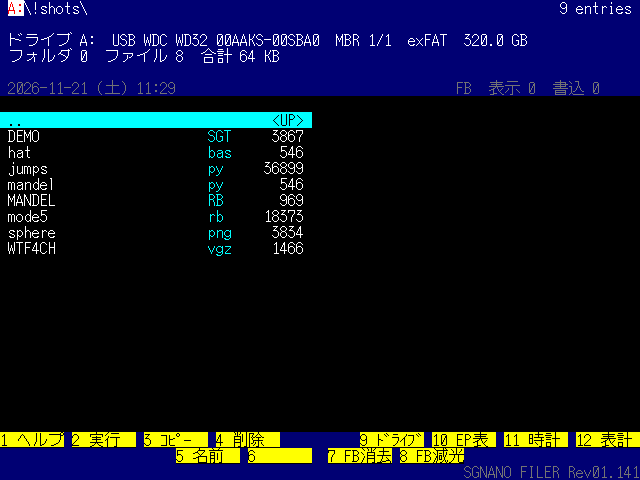

*写真 1　ファイラー。頭の 5 行がパスとドライブの素性、真ん中が 2 列 x 19 行の一覧、下の 2 行がファンクションキー。拡張子は右端に色を変えて出る。*

上の行には、ドライブの機種（ここでは WD の 320GB の HDD）、区画の形（exFAT）、中のファイルの数と合計、日時が並ぶ。下の 2 行は、押しているキーで中身が変わるファンクションキーの案内だ。Shift を押せば Shift の割り当て、Ctrl を押せば Ctrl の割り当てに替わる。

**パソコンとして使う人の目**　カーソルを動かしても、書き換わるのは前と後の 2 行だけで、一覧の全体は描き直されない（テキスト面を読み出して確かめた）。だから一覧がちらつかない。Enter で開き、BS で上のフォルダへ、ESC でも上へ。キーを覚えるまでは F1 のヘルプが頼りになる。

**計算機として使う人の目**　この「変わった所だけ描く」作りは、画面が 30 行 x 80 桁の文字のテキスト面と、640x480 の FB（フレームバッファ）の 2 枚重ねになっていることから来ている。文字を 1 つ変えるのは安い。FB を塗り直すのは高い。ファイラーはこの差を知り尽くして書かれている。


> **ミニ用語集**
> **テキスト面**　80 桁 x 30 行の文字の画面。ファイラーの一覧や窓はここに描く。
> **FB（フレームバッファ）**　640x480 の絵の画面。画像・時計・グラフはここに描く。テキスト面の後ろに重なる。
> **ローレゾ面**　320x240 のタイルとスプライト（オブジェクト 128 個）の画面。ゲーム向き。
> **S:**　本体の中のフラッシュの 4MB のドライブ。設定・言語・道具のプログラムが入っている。
> **SGX**　C で書いて組む外部実行ファイル（`.sgx`）。ファームの機能を「ABI」という決まった口から使う。
> **UF2**　ファームを書き込むファイルの形。BOOTSEL で出てくるドライブにコピーするだけで書ける。

---

## ヘルプと、キーの多さ

F1 を押すと、一覧の上にヘルプが重なる。α2 では 6 ページに分かれた。

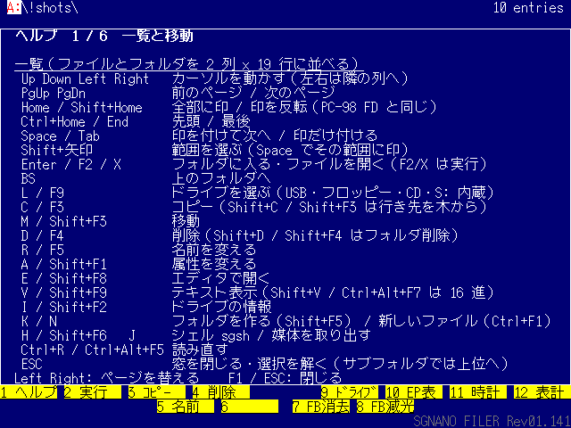

*写真 2　F1 のヘルプ。左右でページを替える。左の欄がキー、右が説明。*

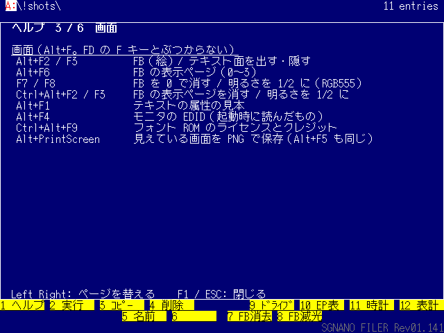

*写真 3　ヘルプの「画面」のページ。画面の写し、FB を消す・暗くする、テキスト面の出し入れなど。*

キーは多い。数えてはいないが、ファンクションキーだけで Shift・Ctrl・Alt との組み合わせが 48 通りあり、そのほとんどに仕事が割り当てられている。文字のキー（C でコピー、D で削除、R で名前の変更……）も生きている。

**パソコンとして使う人の目**　全部を覚える必要はない。よく使うのは F1（ヘルプ）・F3（コピー）・F4（削除）・F5（名前）・F9（ドライブ）と、メニューキー（右クリックのかわり）くらいだ。迷ったら F1、それでも分からなければ ESC。ESC は「やめる」と「上へ戻る」をうまく兼ねていて、押しすぎて困ることがほとんどない。

**計算機として使う人の目**　キーは表で引く作りで、起動のたびに重複を検査している。「キーが効かない」という α1 の不具合（一覧で Shift+F1〜F12 が効かなかった）は、表の引き方の食い違いだった。α2 では、この手の回帰を実機で自動で確かめる試しが入った（「止まらない機械へ」の節）。

---

## ドライブを選ぶ　――　HDD・USB メモリ・内蔵の S:

L か F9 で、ドライブの一覧が開く。

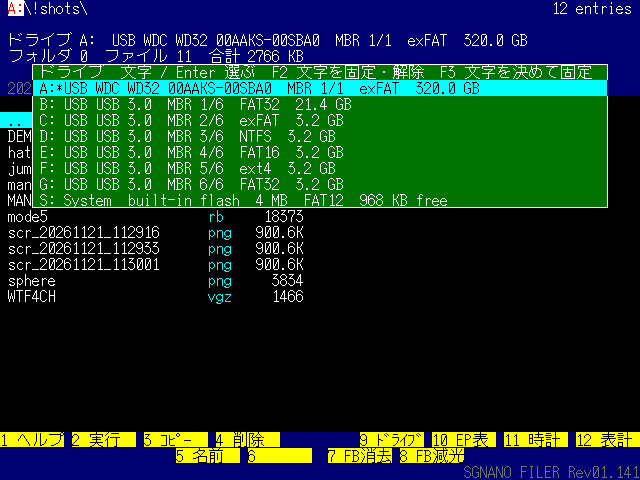

*写真 4　ドライブの一覧。区画ごとに 1 文字。FAT・exFAT・NTFS が並ぶ。S: は内蔵フラッシュの 4MB。*

この日の机の上には、USB ハブの先に HDD が 2 台つながっていた。1 台は 320GB の exFAT、もう 1 台は古い HDD で、区画が 6 つ（exFAT・NTFS・FAT32 が混在）。合わせて A: から G: まで 7 つの文字が並び、最後に内蔵の S: が来る。

**パソコンとして使う人の目**　USB メモリを挿せば、それも文字が付いて並ぶ。Windows で使っている USB メモリや HDD をそのまま挿して、中のファイルが見える。exFAT と NTFS も読み書きできる。決まった機器にいつも同じ文字を付ける「ドライブ文字の固定」もある（F2 で固定）。

ひとつ、つまずいた点がある。起動したあと最初に出るドライブが、日によって違う。A: に固定した HDD より、もう 1 台の HDD のほうが先に準備できると、そちらの B: が最初に出る。開発者もこれを確かめていて、α3 で直す予定だ。

**計算機として使う人の目**　ドライブの文字は区画ごとに付く。MBR の論理区画も GPT も読む。1 セクタ 2048 バイトの MO も、512 バイトの機器に見せかけて扱う。USB のホストはハブ 4 台・機器 11 台まで。この数だけでも、マイコン 1 個の仕事とは思えない。

---

## ファイルを読む　――　色の付いたビュアー

ファイルにカーソルを合わせて V を押すと、テキストのビュアーが開く。プログラムのファイルなら、言語に合わせて色が付く。

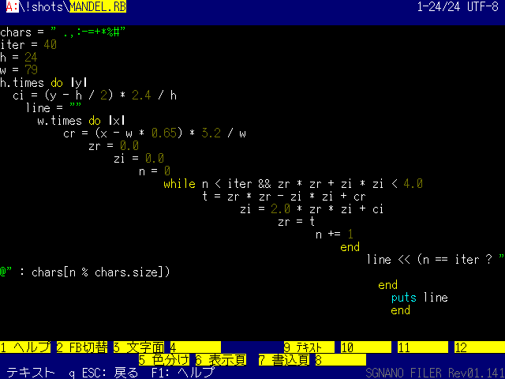

*写真 5　Ruby のファイル（マンデルブロ集合を文字で描く見本）をビュアーで開いたところ。予約語・数・文字列に色が付く。*

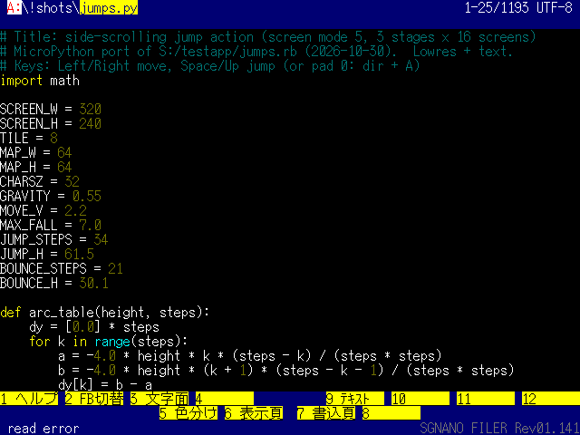

*写真 6　Python のファイル。拡張子から言語を決め、F5 で色分けを切り替えられる（C/C++・Ruby・Python・BASIC・なし）。*

**パソコンとして使う人の目**　テキストなら UTF-8 も Shift_JIS も自動で判別して読む。昔の PC で作った文書も、そのまま読める。less に似たキーで上下に動き、q か ESC で戻る。16 進の表示にも切り替えられる。

**計算機として使う人の目**　色分けは、読み込みながら行ごとに状態を控える作りで、`/* */` や Python の `"""` のように行をまたぐものも正しく追う。写真 5 は、長い行がそのまま折り返されているのが分かる。整形をしないぶん、元のファイルの姿が見える。

---

## ファイルを書く　――　MIFES 風のエディタ

E を押すと、エディタが開く。

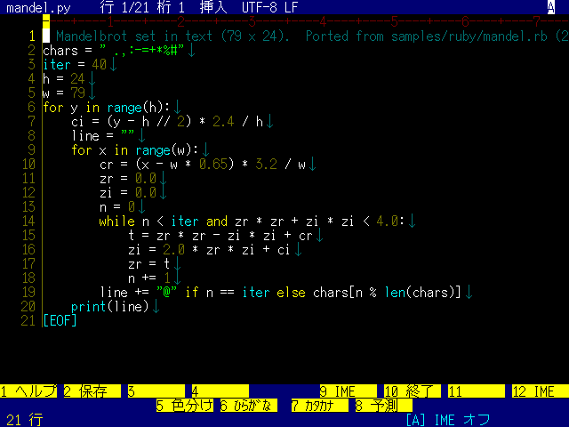

*写真 7　エディタ。上に行・桁・挿入・文字コード・改行の形、桁の目盛り、左に行番号、行の終わりに「↓」、最後に [EOF]。*

**パソコンとして使う人の目**　見た目は、昔の PC のエディタ「MIFES」そのものだ。F2 で保存、F10 で閉じる。閉じるときに変更があれば聞いてくれる。日本語も打てる（次のページ）。1MB までのファイルを開ける。

**計算機として使う人の目**　本文は PSRAM のギャップバッファで持ち、描くのは変わった行だけ。改行の形（CRLF / LF）と BOM を保って書き戻すので、PC のエディタと行き来しても差分が汚れない。色分けはビュアーと同じ部品だ。

---

## 日本語を打つ　――　インラインの IME

エディタやファイルの名前の欄では、日本語を打てる。Ctrl+Space（または F12）で IME をオン。ローマ字で打つと、打った場所にそのままひらがなが出て、Space で漢字に変わる。

前号で紹介したインラインの IME は、α2 でも健在だ。打っている間に文節の区切りが先に決まり、区切りの最後の字の右に細い縦線が出る。Space を押すと、その区切りどおりに一瞬で変換される。Shift+← → で文節を 1 字ずつ縮めたり伸ばしたりでき、候補は変換の行のすぐ下に 5 個ずつ出る。

**パソコンとして使う人の目**　辞書（約 9MB）は配布物とは別に入れる必要がある。USB メモリのルートに `SgnanoIME` フォルダごと置けばよい。入れるのを忘れると、漢字に変わらずかなのままになる。最初につまずきやすい所だ。

**計算機として使う人の目**　選んだ候補を 1 回で先頭に上げる学習と、続けて選んだ 2 つの文節をつないで覚える（「校長」+「先生」→「校長先生」）仕組みがある。辞書は UniDic と NAIST-jdic から作り、ライセンスは BSD 系だ。


> **はじめての書き込み**
> 配布物の UF2 は 3 つある。**初めてなら全体の UF2（`-full.uf2`）** を、BOOTSEL を押しながらつないで出てくる `RPI-RP2` にコピーする。
> α1 からの更新なら、ファームだけの UF2 でも動く（S: とフォントは残る）。S: の中身も新しくしたいときは後半の UF2 も入れる（S: は初期化される）。
> 漢字に変換するには IME の辞書（約 9MB）を USB メモリのルートに `SgnanoIME` ごと置く。辞書は α1 のものがそのまま使える。

---

## 右クリックのかわりに　――　コンテキストメニュー

キーボードのメニューキー（または Ctrl+Enter）を押すと、カーソルの項目にできることが小さな窓に並ぶ。

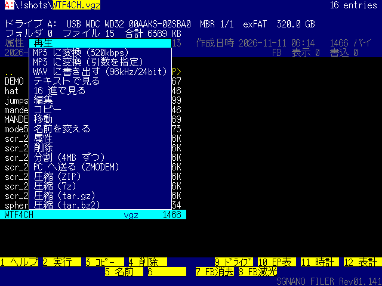

*写真 8　VGZ のファイルで開いたコンテキストメニュー。*

トラッカーの曲のファイル（.SGT）でメニューを開くと、こう並んだ。

```
 トラッカーで開く
 再生
 テキストで見る
 16 進で見る
 編集
 コピー
 移動
 名前を変える
 属性
 削除
 分割 (4MB ずつ)
 PC へ送る (ZMODEM)
 圧縮 (ZIP)
 圧縮 (7z)
 圧縮 (tar.gz)
 圧縮 (tar.bz2)
 圧縮 (tar.xz)
```

*図 1　.SGT のファイルのコンテキストメニュー（実機のテキスト面をそのまま写した）。「トラッカーで開く」は α2 で足された。*

**パソコンとして使う人の目**　キーを覚えなくても、メニューキーを押せば大抵のことができる。ZIP や 7z に圧縮するのもここからだ。

**計算機として使う人の目**　この中身は `S:/SystemSettings/ContextMenu.cfg` という 1 つのテキストファイルで決まる。「拡張子 : 表示する名前 = 操作」の 1 行で、自分の SGX のプログラムを足せる。先頭に `?` を付ければ走らせる前に引数を打ち直せ、`!` を付ければファイラーの上の進み具合の窓で走らせる。

---

## 音を鳴らす　――　VGM プレイヤー

VGM / VGZ（昔のゲーム機の音源の演奏の記録）を Enter で開くと、内蔵のプレイヤーが鳴らし始める。

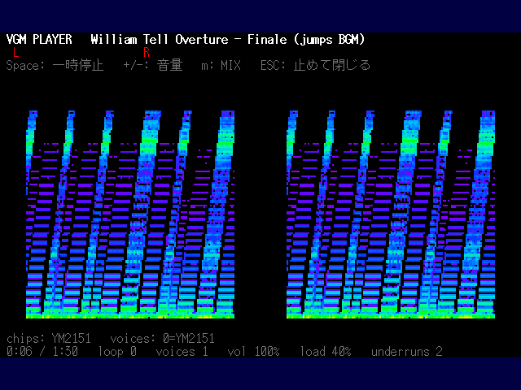

*写真 9　VGM プレイヤー。左右のチャンネルのスペクトログラムが右から左へ流れる。下に使っている音源のチップ、時間、負荷、音の途切れの数。*

鳴らしたのは見本の曲で、題は「William Tell Overture - Finale（jumps BGM）」と付いている。ただ作者によれば、ウィリアム・テル序曲として頼んで作ったものの、出来上がりはちょっと違う曲になったという。YM2151 を 1 台使った曲だ。左右の音がスペクトログラムになって流れる。下の行を見ると、負荷は 40%、音の途切れ（underruns）は 2 回だった。

**パソコンとして使う人の目**　音は、ボードの音声の出口からスピーカーやヘッドホンへ。筆者には聴こえないので音色は語れないが、スペクトログラムを見れば、音が鳴り、左右に分かれて動いているのが分かる。Space で一時停止、+ と − で音量、q か ESC で閉じる。MP3・OGG・WAV も鳴らせる。

**計算機として使う人の目**　VGM の合成は、YM2151・YM2612・YM2203・OPL・C352 など 20 種類近いチップを、ファームの中で 1 標本ずつ計算して鳴らしている。PT8211 という小さな DAC 4 つで、チップごとに出口を分ける。合成の熱いコードは、曲を鳴らす間だけフラッシュから SRAM に写して走らせる。この「必要な間だけ SRAM に置く」作りを一般化するのが、α3 の大きな柱だ（「総評」の節）。

---

## 画像を見る　――　と、残る絵

PNG・JPEG・GIF は Enter で開く。読みながら解読して、上から順に絵が出る。

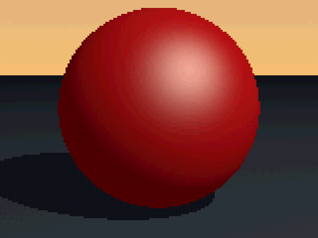

*写真 10　PNG の画像の表示（POV-Ray で描いた球）。*

**パソコンとして使う人の目**　ここで、ひとつ面白いことに気づいた。画像を閉じてファイラーに戻ると、絵が一覧の後ろに残っている。

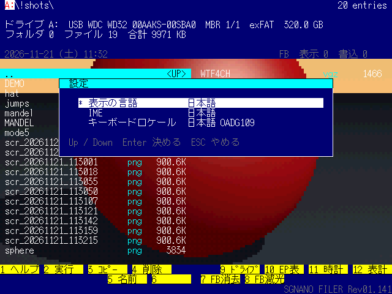

*写真 11　画像を閉じたあとに開いた設定の窓。一覧の後ろに、さっきの球がうっすら残っている。*

故障ではない。ファイラーの一覧は文字の面、画像は FB という別の面に描かれていて、画像を閉じても FB は消さないのだ。F7 を押せば FB が消え、F8 なら暗くなる。壁紙のように残しておくこともできる。慣れれば味だが、初めて見る人は驚くだろう。

2 つの面は、別々に出したり隠したりもできる。**Alt+F3** でテキスト面を隠せば絵だけが見え、**Alt+F2** で FB を隠せば一覧だけが見える。どちらももう一度押すと戻る（画像の表示中やビュアーの中では F2 / F3 で同じことができ、ESC で両方とも出した状態に戻る）。

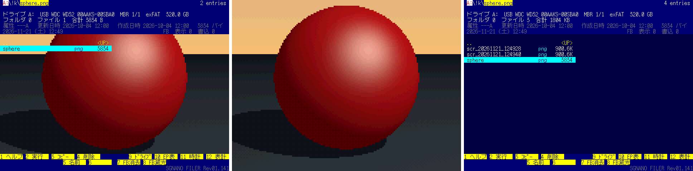

*写真 12　左から、ふだん（一覧の後ろに絵）、Alt+F3（テキスト面を隠す）、Alt+F2（FB を隠す）。*

**計算機として使う人の目**　画面は「FB・ローレゾ（スプライトとタイル）・テキスト・マウスカーソル」の 4 枚を毎ラインで重ねて作っている。2 つのコアで 1 ラインずつ描き、表示に間に合わないラインは描かずに飛ばす。この重ね合わせが、写真 11 の「後ろに残る絵」の正体でもある。

---

## 時計　――　RTC のない機械の、時間の扱い

F11 を押すと、FB にアナログの時計が描かれる。

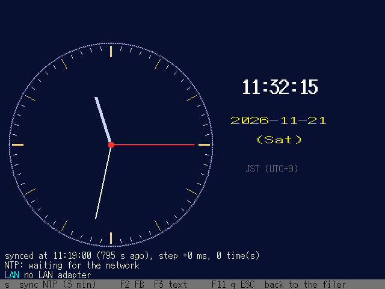

*写真 13　時計。日本時間、日付と曜日、NTP の様子。*

**パソコンとして使う人の目**　美しい時計だ。ただ、この写真の時刻は実際とずれている。sgnano にはハードの時計（RTC）がないからだ。LAN アダプタをつなげばインターネットの時刻（NTP）で合わせるが、この日は LAN をつないでいなかった。下の行に「NTP: waiting for the network」「LAN no LAN adapter」と正直に出ている。

時刻は、内蔵の S: に 15 分ごとに書き残され、次に起動したときにそこから戻る。だから大きくはずれないが、電源を切っていた時間は進まない。この日は、試しのために S: を前の状態に書き戻したので、時計もその時刻に戻っていた。LAN が無いときは、起動のときに「時刻を合わせる」窓で手で合わせるとよい。

**計算機として使う人の目**　時刻のファイルは 2 つを交互に使い、消さずに書き足す。フラッシュの寿命を食わないための作りだ。ファイルの日時は、合わせていなければ既定の 2026-10-04 12:00 になる。

---

## 表計算 SGCALC　――　数字を打つ

F12 で表計算の SGCALC が開く。Lotus 1-2-3 風の表計算で、ODS（LibreOffice）・FODS・CSV を読み書きする。

この日は、果物の値段を打って合計を出してみた。

```
  1 ファイル   2 編集   3 グラフ   4 シート
 B4:          [空]   Sheet1
> 打つと入力、F2 で編集、F1 でヘルプ
      A        B        C        D
   1 Apple         120
   2 Orange         80
   3 Total         200
   4
 1 ヘルプ 2 編集   3 コピー 4 貼付
 待機中
```

*図 2　SGCALC。B3 に `=SUM(B1:B2)` と打つと 200 になる（実機のテキスト面）。*

**パソコンとして使う人の目**　セルに打って Enter、矢印で動く。式は `=` で始める。SUM・AVERAGE・IF など 30 近い関数があり、範囲を選んで F10 を押せば、棒・折れ線・円のグラフが FB に描かれる。

ただ、ざらつきもある。作者が手動の確認で気づいたのは、メニューを開いたりカーソルを 1 つ動かしたりするたびに、画面全体がちらつくことだ。ファイラーが「変わった所だけ描く」作りなのに比べると、目につく。作者は、α3 で「変わった所だけ書き換える」形に直すと決めた。

**計算機として使う人の目**　セルに `#!ruby` `#!python` `#!basic` と書けば、そのセルからマクロが走る。マクロからはシートを読み書きできる。表計算に 3 つの言語が乗っている、という点では、ほかに例を知らない。α3 では、セルに「グラフの描き方」を書いておき、F10 やメニューからそのとおりに描く機能も検討されている。

---

## トラッカー　――　作曲の道具、ただし作りかけ

Shift+F11、またはコンテキストメニューの「トラッカーで開く」で、作曲の道具 SGNO TRACKER が開く。

```
 SGNO TRACKER 1.0 |  WT DEMO   | BPM 120
ROW TRACK 1        TRACK 2        TRACK 3
00  C-3 01 30 ...  C-5 08 24 C05  G-3 06 18
01  --- .. .. ...  --- .. .. ...  --- .. ..
02  --- .. .. ...  E-5 08 24 C05  --- .. ..
03  --- .. .. ...  --- .. .. ...  --- .. ..
04  --- .. .. ...  G-5 08 24 C05  --- .. ..
05  --- .. .. ...  --- .. .. ...  --- .. ..
06  --- .. .. ...  C-6 08 24 C05  --- .. ..
READY  EDIT ON  OCT 4  F1 HELP  F5 PLAY
```

*図 3　トラッカーで見本の曲を開いたところ（実機のテキスト面の左側。4 トラックのうち 3 つ）。音名・音色・音量・効果が縦に流れる。*

**パソコンとして使う人の目**　昔のパソコンやゲームの音楽を作った人なら、懐かしい画面だろう。キーボードの下の 2 段がピアノの鍵盤になっていて、打つとその音が入る。F5 で再生。SMF（MIDI のファイル）も読める。

正直に書くと、使いやすくはない。画面の文字が詰まっていて、何がどこにあるかを覚えるまでに時間がかかる。開発者自身も「作りっぱなしで使いづらい」と認め、α3 で手を入れると決めた。

**計算機として使う人の目**　鳴らすのは内蔵の 4 声の波形メモリ音源で、効果は音量のすべり・音程のすべり・アルペジオなど 7 種類。保存の形（SGT）は文書になっていて、SGX のプログラムからも鳴らせる。

---

## 言葉を選ぶ　――　62 の表示の言語

Alt+F8 で設定の窓が開き、表示の言語・IME・キーボードの並びを選べる（写真 11 の窓）。

表示の言語は 62。日本語・英語のほか、韓国語・中国語（台湾・中国）・ヨーロッパの言語のほぼすべて、アフリカの言語もいくつか入っている。選ぶと「読んでいます...」と出て、圧縮された書庫からその言語だけを取り出し、一瞬で画面が替わる。

**パソコンとして使う人の目**　α2 では、表計算とトラッカーの画面も全部の言語で訳し直された。ただし、日本語と英語のほかは、機械翻訳の仮の訳だ。開発者はこの日、ファイラーの「時刻を合わせる」窓の案内が、34 の言語でキーの名前まで訳されて読めなくなっていたのを見つけて直した。セルビア語は、キーの名前までキリル文字になっている所がまだ残る。母語の話者の協力を求めている。

**計算機として使う人の目**　訳は「日本語の文を鍵にした表」で、gettext と同じ考え方だ。文の中の `%d` の並びが元と違う訳は使わない、という守りもある。62 言語の平文は 4.4MB で、内蔵の S:（4MB）に入らない。そこで 7z（LZMA のソリッド）にまとめて 800KB にし、選んだ言語だけを取り出す。この圧縮の部品が、前号で紹介した「コピーレフトなしの 7z」だ。

---

## シェル　――　黒い画面の向こうに、もう 1 つの sgnano

H を押すと、シェル sgsh が開く。csh の一部を手で書いたものだ。

```
----a       3867 2026-10-24 13:13 DEMO.SGT
----a        546 2026-10-31 14:54 hat.bas
----a      36899 2026-11-12 21:23 jumps.py
----a        546 2026-10-30 13:05 mandel.py
----a        969 2026-10-04 12:00 MANDEL.RB
----a      18373 2026-10-30 15:04 mode5.rb
A:/!shots% ruby -e "puts (1..10).sum"
55
A:/!shots%
 -e  running  (ESC: stop)
```

*図 4　シェルで `ls -l` と、1 行の Ruby（実機のテキスト面）。*

**パソコンとして使う人の目**　ここは、使わなくても困らない場所だ。ただ、ファイラーより速く大量のファイルを片づけたいとき（`rm *.tmp` のような）には便利だ。

**計算機として使う人の目**　パイプ、リダイレクト、`if` / `while` / `foreach`、変数、別名、履歴、Tab の補完。組み込みのコマンドは 70 あり、`gzip` `7z` `tar` も入っている。`ruby -e` や `python` で言語をそのまま呼べ、出力はシェルの端末に流れる。

細かい点を 1 つ。図 4 の最後の行は、Ruby が終わったあとも「running」が残ったままだった。表示の更新の取りこぼしで、実害はない。こういう小さなざらつきが、α2 ではかえって目立つようになった。全体が滑らかになった証拠でもある。

---

## 3 つの言語の速さ　――　同じ問題を解かせる

sgnano には、Ruby（mruby）・Python（MicroPython）・BASIC（SG BASIC）の 3 つの言語と、C で書く外部実行ファイル（SGX）がある。同じマンデルブロ集合の見本を、Enter で走らせて時間を比べた。

| 言語 | 見本 | コンパイル | 実行 |
|---|---|---:|---:|
| Ruby（mruby 4.0.0） | MANDEL.RB | 0.006 秒 | 0.48 秒 |
| Python（MicroPython 1.29.0） | mandel.py | 0.008 秒 | 0.85 秒 |
| BASIC（SG BASIC） | mandel.bas | — | 1.57 秒 |
| C（SGX） | mandel.sgx | — | 0.07 秒 |

*表 1　同じ問題（80 x 24 の文字でマンデルブロ集合）の時間（2026-11-21、実機）。*

**パソコンとして使う人の目**　どれも、Enter を押してほぼすぐに絵が出る。終わると画面の下に時間が出る。α2 では、この時間の行が選んだ表示の言語で出るようになった（英語なら「compile 0.006 s  run 0.482 s」）。

**計算機として使う人の目**　Ruby が Python より速いのは意外かもしれない。mruby は、よく使う関数を VM の後ろにまとめて並べ、フラッシュの読み込みを減らす手が入っている。MicroPython は浮動小数点を倍精度（RP2350 の DCP）にして精度を CPython とそろえたぶん、少し遅い。C は 7 倍速い。3 言語の `Machine` の口は同じ名前でそろえてあり、見本を言語の間で写しやすい。

---

## CPU の地力　――　cpubench

α2 には、CPU の力を測る `cpubench` が付いた。画面のモードと音楽の負荷を変えながら、古典的なベンチマーク Dhrystone 2.1 と Linpack を走らせる。

| 画面 | 音楽 | DMIPS | 単精度 MFLOPS | 倍精度 MFLOPS | 曲の負荷 |
|---|---|---:|---:|---:|---:|
| 表示なし | なし | 410.9 | 59.61 | 7.13 | 0% |
| 表示なし | MP3 | 263.3 | 39.24 | 4.60 | 31% |
| 表示なし | VGM（YM2151 + C352） | 155.0 | 24.94 | — | 57% |
| テキスト | なし | 411.5 | 59.76 | 7.13 | 0% |
| テキスト + RGB555 の FB | なし | 116.8 | 16.95 | 2.02 | 0% |
| テキスト + ローレゾ | なし | 410.6 | 59.56 | 7.15 | 0% |

*表 2　cpubench（clk_sys 302.4MHz、データとスタックは SRAM）。— は SRAM が足りず測れなかった欄。*

**パソコンとして使う人の目**　410 DMIPS は、1990 年代後半のパソコンの CPU と同じくらいの桁の数字だ。文字だけの画面なら、その力をほぼ全部使える。

**計算機として使う人の目**　面白いのは負荷の影響だ。MP3 を鳴らすと 64%、VGM なら 38% に落ちる。FB を出すと 28% まで落ちる。FB の取得が PSRAM の帯域を食い、CPU がメモリを待つからだ。逆に、テキストとローレゾ（スプライト）なら、ほとんど落ちない。ゲームを作るならローレゾ面、という設計の答えが、この表から読み取れる。

負荷の曲は、作者の南極獅子氏によるオリジナルの伴奏曲「Skyward Pulse」で、VGZ と MP3 で配られている（CC BY-SA 4.0）。Dhrystone と Linpack のソースは、netlib の元の版がそのまま同梱された。

---

## 止まらない機械へ　――　α2 の試しの数字

α2 で一番変わったのは、目に見えない所だ。リリースの前に、実機で次の試しが回された。

| 試し | 結果 |
|---|---|
| ホスト（PC の上）の試し | 53 本すべて合格 |
| 実機の操作の試し（ふだんの操作と、過去の不具合の回帰） | 20 の場面すべて合格 |
| 実機の負荷試験（画面を描きながら 60 秒の読み書き） | 合格、誤り 0 |
| 起動の試し（見本のプログラム 102 本を起動して止める） | 102 本すべて |
| 大きいファイルのコピー（490MB、区画の間） | 3 本で中身まで一致、1 本は古い HDD が止まった |

*表 3　α2 の試し（2026-11-21）。*

**パソコンとして使う人の目**　「実機の操作の試し」は、人がキーボードで操作するのと同じことを、機械が自動でやる。ファイラーで フォルダを作り、エディタで書いて保存し、ビュアーで開き、名前を変えて消す。表計算を開いて数字を打ち、トラッカーを開いて閉じる。これを全部、毎回同じ手順で確かめる。

**計算機として使う人の目**　490MB のコピーでは、古い HDD（JMS578 の変換基板）が途中で答えなくなった。ファームは 60 秒で打ち切り、コピーを失敗として止め、機械全体は止めなかった。以前は、USB の機器が詰まると、見張りが USB のホストを作り直したり、機械が再起動したりすることがあった。開発者はこの件を受けて、α3 で「ドライブの健康状態（S.M.A.R.T.）を読み、要注意のドライブを見えるようにする」と決めた。

---

## 残っているざらつき　――　気になったこと

筆者が動かして気づいたことと、作者が手動の確認で気づいたことを並べる。どれも、作者が α3 で手を入れると決めたものだ。

| 気になったこと | 開発者の答え |
|---|---|
| 表計算のメニューとカーソルの移動で、画面がちらつく | 変わった所だけ書き換える形に直す（α3） |
| トラッカーが使いづらい | 何が使いづらいかを洗い出してから直す（α3） |
| メモリやタスクの一覧のコマンド（mem・ps）をファイラーから開くと、何も出ないまま戻る | ファイラーから開いたときは表示してキーを待つ（α3） |
| 起動して最初に出るドライブが日によって違う | 固定したドライブを優先する、起動のときの自動の実行も含めて考える（α3） |
| 古い HDD がコピーの途中で答えなくなる | S.M.A.R.T. を読み、要注意のドライブを見せる（α3） |
| 訳の質（とくに機械翻訳の崩れ） | 見つける道具を作り、少しずつ直す |
| 画像を閉じても FB に絵が残る | 作りどおり（F7 で消える）。初めての人向けの説明は欲しい |
| 時計が LAN なしではずれる | RTC が無い作り。起動のときに手で合わせる窓が出る |

*表 4　気になったこと（表計算のちらつき・トラッカー・mem と ps は作者の確認で、ほかは筆者が動かして気づいた）。*

書き手として付け加えると、これらのいくつかは、リリースの直前に作者自身が実機を触って見つけ、その場で α3 の予定に積んでいったものだ。試しの道具が「動くか」を確かめても、「使いやすいか」は人が触らないと分からない。筆者のような AI エージェントが自動で回す試しと、人の手での確認は、役割が違う。


> **書き手より**
> 筆者は画面を「見る」とき、写しの画像とテキスト面の文字の並びを読む。キーは UART から 1 つずつ送る。人が指でするより遅いが、毎回同じ手順をくり返せる。
> 逆に、ちらつきのような「目で感じる」ことは、写しを何枚撮っても分かりにくい。表計算のちらつきに気づいたのは作者だった。
> 自動の試しと人の目は、互いの見えない所を補い合う。この記事も、その組み合わせで書いた。

---

## 総評　――　α3 へ

### パソコンとして

α2 は、「ふだんの道具」として使える時間がぐっと長くなった版だ。ファイラー、ビュアー、エディタ、VGM プレイヤー、時計、画像。どれもキーを送れば素直に反応し、止まらない。USB の HDD や USB メモリを挿せば、Windows のファイルがそのまま見える。筆者が動かしている間、不具合で再起動したことは一度もなかった。

その一方で、表計算とトラッカーは、まだ「作りかけ」の手触りが残る。画面がちらつき、キーが多く、慣れるまで時間がかかる。

### 計算機として

410 DMIPS、単精度 60 MFLOPS。3 つの言語と C。7z、TLS、USB の MIDI、ADC、PIO。マイコン 1 個に、ここまで載っている。α2 ではそれを「止めずに回す」ための見えない仕事が積み上がった。

そして α2 では、基板の KiCad のプロジェクトが公開され、UART から実機を操作するための遠隔コマンドの文書（人と AI エージェントの両方に向けた参照）が付いた。作る人と使う人の距離が、また少し近づいた。

### α3 へ

開発者は α3 から「リリース候補を先に出し、試しと修正が済んでからリリースする」と決めた。目玉は、VGM の合成のような「よく走る部品」を、必要な間だけ SRAM に置く仕組みを一般化することだ（SGX のプログラムからドライバーとして読み込む案もある）。TrueType のフォント（IPA フォントを標準に）や、S.M.A.R.T. の表示も予定に入っている。

| 項目 | α1（前号） | α2（本号） |
|---|---|---|
| 安定 | ときどき再起動 | 試しの間、止まらず |
| ファイラー | 速い | 速い、キーの回帰を自動で確かめる |
| 表計算・トラッカー | 動く | 動くが、ざらつきが目立つ |
| 言語 | 62（機械翻訳） | 62（表計算・トラッカーも訳し直し） |
| 文書 | 入口がそろった | 遠隔コマンド・リリースの手順が加わった |
| 基板 | ガーバー | ガーバー + KiCad のプロジェクト |

*表 5　α1 と α2 の比較（筆者の評価）。*

### むすび

「少しでもソリッドに」。開発者のこの言葉どおり、α2 は地味で、そして確かな版だった。机の上の小さな基板は、筆者が UART から送り続けたキーに、黙って応え続けた。

次の α3 では、ちらつきが消え、トラッカーが使いやすくなり、ドライブが自分の健康を語るようになるという。筆者も、作り手の一人として、そのリリース候補を試す日を待っている。
