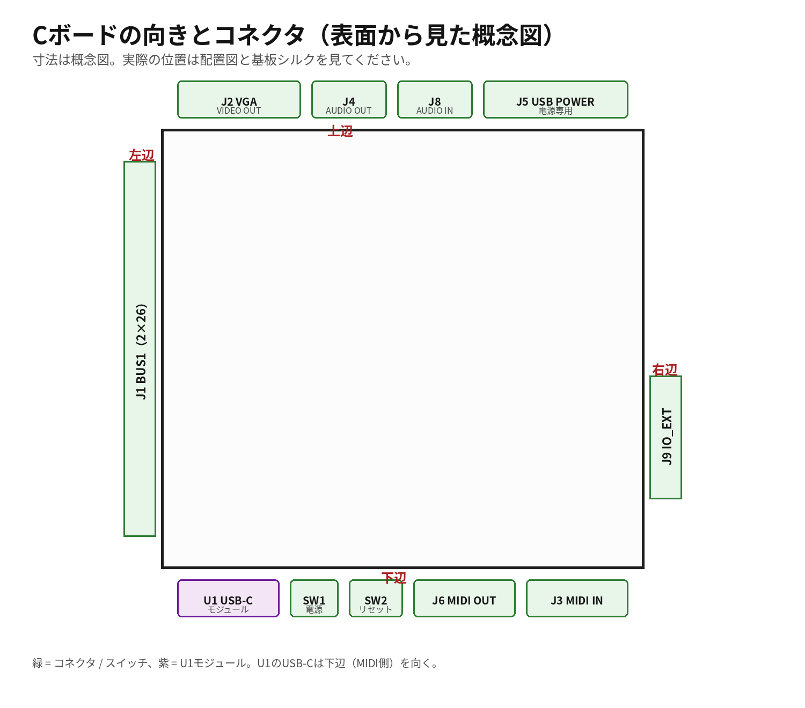
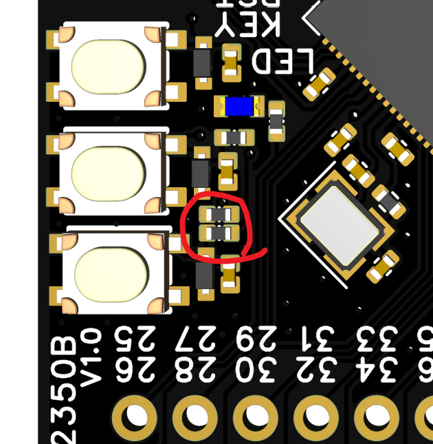
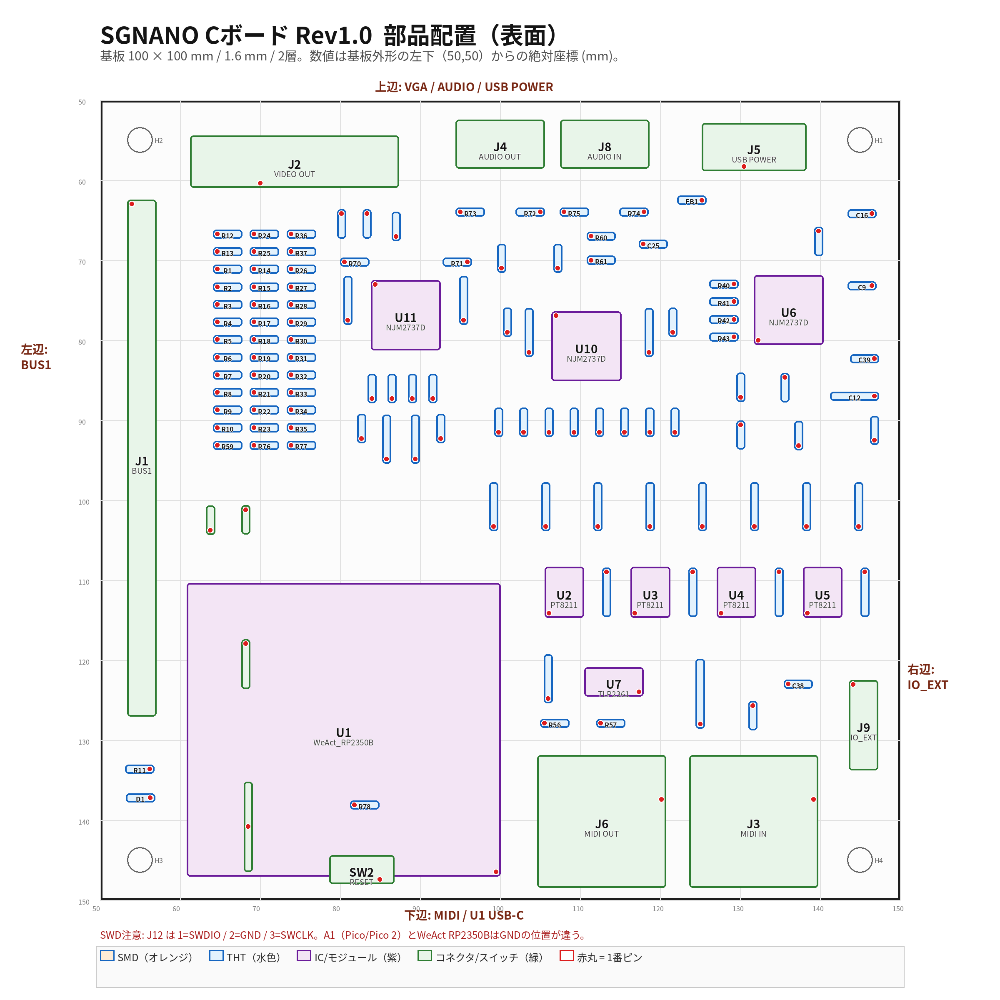
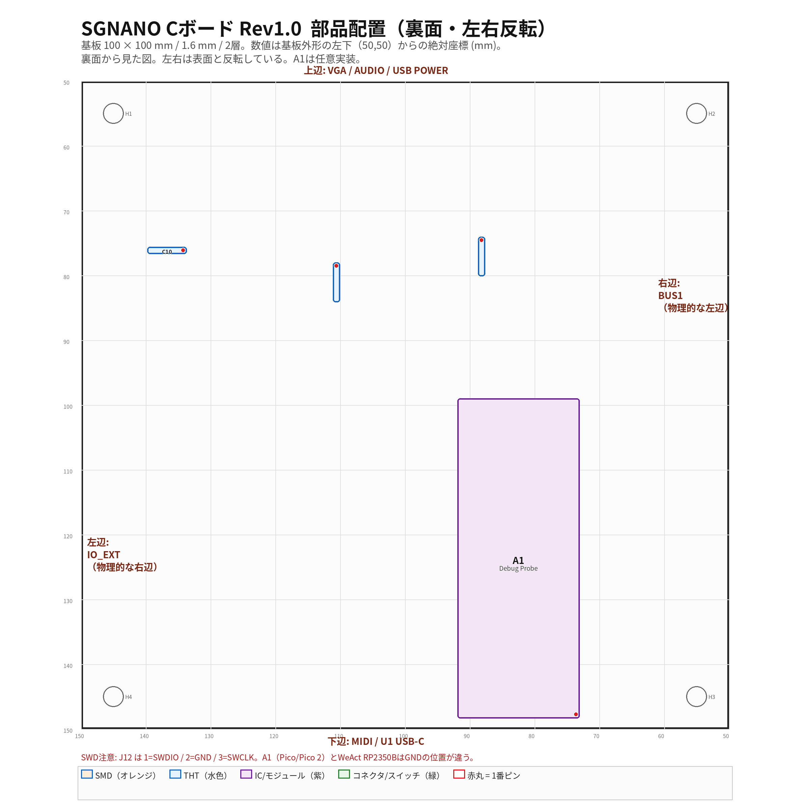

# SGNANO Cボード Rev1.0 組み立てガイド

**表1: 文書の基本情報**

| 項目 | 内容 |
|---|---|
| 対象基板 | SGNANO Cボード Rev1.0（ガーバー `SGNANO_C_BOARD_10.zip`、2026-10-28 出力） |
| 文書版 | 1.0（2026-11-17） |
| 対象読者 | はんだ付けに慣れていない作業者、および実装を指示する人 |
| 範囲 | 部品表（BOM）、実装手順、通電前チェック、初期動作確認 |
| PDF版 | `ASSEMBLY.pdf`（この Markdown から生成） |

---

## 目次

- [1. はじめに](#sec1)
- [2. 基板の概要](#sec2)
- [3. 作業前の準備](#sec3)
- [4. 部品表（BOM）](#sec4)
- [5. 実装手順](#sec5)
- [6. 極性・向きの早見表](#sec6)
- [7. 通電前チェック](#sec7)
- [8. 初期動作確認](#sec8)
- [9. コネクタピン配置](#sec9)
- [10. 注意点・既知の制約](#sec10)
- [11. トラブルシューティング](#sec11)
- [12. 付録](#sec12)

<a id="sec1"></a>

## 1. はじめに

### 1.1 この文書の使い方

この文書は、Cボードを1枚組み立てて、電源を入れ、最低限の動作を確認するまでの手順をまとめたものです。  
初めての人は、次の順番で読んでください。

1. **2章**で基板の全体像とコネクタの向きを確認する。
2. **3章**で工具・部品・安全を確認する。
3. **4章**のBOMで部品をそろえ、数量と値を照合する。
4. **5章**の順番で実装する。
5. **6章**の極性早見表で、向きのある部品を最終確認する。
6. **7章**の通電前チェックを行う。
7. **8章**の初期動作確認を行う。

作業を始める前に、基板を明るい場所に置き、ルーペか拡大鏡を用意してください。  
Cボードは 100 × 100 mm の両面基板で、部品のほとんどが表面（F面）に付きます。裏面（B面）には A1（任意）と C10・C28・C31 の3個のコンデンサだけが付きます。

### 1.2 対象基板と関連ファイル

**表2: 対象基板と関連ファイル**

| ファイル | 内容 |
|---|---|
| `SGNANO_C_BOARD_10.zip` | 製造用ガーバー（銅箔・マスク・シルク・外形・穴の10ファイル） |
| `C_BOARD_BOM.csv` | 部品表（グループ版。購入・数量確認用） |
| `C_BOARD_PLACEMENT.csv` | 1部品ごとの基準番号・座標・面・実装方法 |
| `images/c_board_orientation.png` | 基板の向きとコネクタの概念図 |
| `images/c_board_front.png` | 表面の部品配置図 |
| `images/c_board_back.png` | 裏面の部品配置図（左右反転） |
| `images/weact_pullup_removal.png` | U1（WeAct）のユーザースイッチ用プルアップ抵抗の位置 |
| `ASSEMBLY.pdf` | この文書のPDF版 |

**基板の呼び方**: ガーバー名は `SGNANO_C_BOARD_10` です。この文書では「Cボード Rev1.0」と呼びます。  
**シルクの日付について**: 基板シルクには `Rev1.0 OCT/2027` と印字されていますが、ガーバーの出力日は **2026-10-28** です。文書では 2026-10-28 を正とし、シルクの `2027` は誤植として扱います。  
**シルクの名前**: 基板シルクには `CSG-Nano` と印字されています。これはこのCボードの愛称です。

### 1.3 表記と用語

**表3: 表記と用語**

| 用語 | 意味 |
|---|---|
| 1番ピン | ICやコネクタの基準のピン。基板上では四角いパッド、シルクの三角マーク、部品の点や切欠きで示される |
| アノード（A） | ダイオード・LEDの＋側。LEDでは脚が長い方 |
| カソード（K） | ダイオード・LEDの−側。LEDでは脚が短い方、ダイオードでは帯の側 |
| SMD | 基板の表面に直接はんだ付けする部品（この基板では PT8211 と TLP2361） |
| THT | 穴に脚を通してはんだ付けする部品（抵抗・コンデンサ・コネクタなど） |
| DIP | 2列のピンを持つICのパッケージ。この基板では NJM2737D が DIP-8 |
| SOP / SO | 表面実装用のICパッケージ。PT8211 は SOP-8、TLP2361 は SO-5 |
| PTH / NPTH | メッキ穴 / メッキなし穴。M3の取付穴は NPTH |
| F面 / B面 | 基板の表面 / 裏面。この文書では「表面」「裏面」と書く |

---

<!-- pagebreak -->

<a id="sec2"></a>

## 2. 基板の概要

### 2.1 主な仕様

**表4: 主な仕様**

| 項目 | 仕様 |
|---|---|
| 外形 | 100 × 100 mm、板厚 1.6 mm、2層基板 |
| 取付穴 | M3用 3.2 mm 穴 × 4（基板の四隅） |
| CPUモジュール | WeAct Studio RP2350B Core Board（16MB Flash。PSRAMは未搭載で、ESP-PSRAM64Hを裏面に追加） |
| 映像 | VGA 15ピン（ミニD-Sub 15pin、高密度3列、メス） |
| 音源 | PT8211 × 4（1チップ = 1声、ステレオ） |
| 音声入力 | 3.5mm ステレオジャック（ライン入力） |
| 音声出力 | 3.5mm ステレオジャック（ライン出力） |
| MIDI | DIN 5ピン × 2（IN / OUT） |
| バス | 2 × 26 ピンヘッダ（2.54 mm） |
| 拡張 | 2 × 5 IDC（IO_EXT）、UARTジャンパ × 2、SWD 3ピン |
| 電源 | USB B（5V、電源専用）、スライドスイッチで入切 |
| 任意実装 | A1: Raspberry Pi Pico / Pico 2（最新版のdebugprobeファームウェアを推奨）。**ピン配置はPico/Pico 2用で、U1のWeAct RP2350Bとは並びが違う** |

### 2.2 基板の向きとコネクタ

基板を表面から見て、コネクタのある辺を次のように呼びます。実装中に「どちらが上か」が分からなくなったら、この表に戻ってください。



**図1: 基板の向きとコネクタ（表面から見た概念図）**


**表5: 基板の向きとコネクタ**

| 辺 | コネクタ・部品 | 備考 |
|---|---|---|
| 上辺 | J2 VGA、J4 AUDIO OUT、J8 AUDIO IN、J5 USB POWER | コネクタ本体は基板の外へ張り出す |
| 下辺 | U1 の USB-C、SW1 電源、SW2 リセット、J6 MIDI OUT、J3 MIDI IN | U1 の USB-C は下辺を向く |
| 左辺 | J1 BUS1（2×26） | ピン1は上側の四角パッド |
| 右辺 | J9 IO_EXT（2×5 IDC） | ピン1は左側の四角パッド |
| 表面 | U1、U2〜U5、U6、U7、U10、U11、抵抗・コンデンサ・コネクタ類 | ほとんどが表面 |
| 裏面 | A1（任意）、C10、C28、C31 | 裏面は部品が少ない |

取付穴の位置は、基板の左下を (50, 50) としたとき、次の4点です。

**表6: 取付穴の位置**

| 穴 | 座標 (mm) |
|---|---|
| H2（左上） | (55, 55) |
| H1（右上） | (145, 55) |
| H3（左下） | (55, 145) |
| H4（右下） | (145, 145) |

### 2.3 電気の流れ（概要）

実装の前に、電源と信号の流れをざっと把握しておくと、故障の切り分けが楽になります。

- **電源**: J5 の USB B から入った 5V は、SW1 を通って U1（WeActモジュール）の VBUS に入ります。U1 の 5V 出力が基板の +5V レールになり、U1 の 3.3V レギュレータが +3V3 を作ります。+5V は FB3 を通って +5VA（アナログ用5V）になります。GND は FB1・FB2 を通って GNDA（アナログGND）・GNDV（VGA用GND）に分かれます。
- **映像**: U1 の GP1〜GP15 から、330Ω / 180Ω のラダー抵抗を通って VGA の R・G・B になります。GP16 / GP17 が HSYNC / VSYNC です。
- **音**: U2〜U5 の4個の PT8211 が、それぞれ L/R のアナログ音を出します。C1〜C8 で直流を切り、R44〜R51 の 47kΩ で U10 に混ぜ、U11 のローパスフィルタを通して J4 から出ます。音声入力は J8 から C9 / C16 を通り、U6 で受けて ADC（GP46 / GP47）へ入ります。
- **MIDI**: J3 の MIDI IN は R58 と D2 を通って U7（TLP2361）で受光し、GP43 へ入ります。MIDI OUT は GP42 から R56 を通って J6 へ出ます。
- **バス**: J1 は U1 の GPIO と +3V3 / +5V / GND を外部へ出します。J9 は GP34〜GP41 と +3V3 / GND を出します。

---

<a id="sec3"></a>

## 3. 作業前の準備

### 3.1 工具と材料

**工具**

**表7: 工具**

| 工具 | 用途 | 目安 |
|---|---|---|
| 温度調整はんだごて | THT / SMD のはんだ付け | 320〜350℃、こて先は細めと平らなもの |
| 鉛フリーはんだ | 0.5〜0.8 mm | SAC305 など |
| フラックス | SMD・細かいピン | ペン型かゲル状 |
| はんだ吸い取り線 | ブリッジ修正 | 0.8〜1.5 mm幅 |
| ピンセット | SMD の保持 | 先が細く、曲がりにくいもの |
| ニッパー | 脚の切断 | 先の細いもの |
| ルーペ / 拡大鏡 | はんだ検査 | 3〜10倍 |
| テスター | 導通・電圧 | ブザー付きが便利 |
| イソプロピルアルコール（IPA） | フラックス洗浄 | 無水 or 99% |
| 歯ブラシ / 綿棒 | 洗浄 | 柔らかいもの |
| 耐熱テープ（カプトンテープ） | A1の絶縁保護、コネクタ固定 | 幅 10 mm 程度 |
| マスキングテープ | はんだ付け時に部品を抑える | 幅 10〜20 mm 程度 |
| 静電気防止リストバンド | IC・モジュール保護 | できれば必須 |

<!-- pagebreak -->

**材料・確認用**

**表8: 材料・確認用**

| 材料・器具 | 用途 | 目安 |
|---|---|---|
| 5V USB アダプタ | 電源 | 5V / 1A 以上 |
| USB B ケーブル | J5 への給電 | 電源専用 |
| USB-C ケーブル | U1 の書き込み・給電 | データ対応 |
| VGA ケーブル / モニタ | 映像確認 | 15ピン |
| 3.5mm ステレオケーブル / アンプ | 音声確認 | ライン入力 |
| MIDI ケーブル / キーボード | MIDI 確認 | 5ピン DIN |

### 3.2 安全と静電気対策

- はんだ付けの煙は吸わないでください。窓を開けるか、吸煙器を使ってください。
- はんだごての先は 300℃以上です。コードを引っかけない、こて先を人に向けない。
- 電源を入れた状態ではんだ付けしないでください。必ず USB ケーブルを抜き、SW1 を OFF にしてください。
- 電解コンデンサは極性を逆にすると膨張・破裂することがあります。最初の通電は顔を近づけず、安全眼鏡を着けてください。
- IC・モジュールは静電気に弱いです。作業前に金属の机やドアノブに触れて静電気を逃がし、できればリストバンドを使ってください。
- 基板は導電性の台の上に置かないでください。乾いた紙やプラスチックの台の上で作業してください。
- 電源には必ず 5V の絶縁された USB アダプタを使ってください。AC100V の配線には触れないでください。

### 3.3 部品の確認

作業を始める前に、部品を種類ごとに小分けして、BOMの数量と照合してください。特に次の点を確認します。

- [ ] 抵抗の値は正しいか。330Ω と 33Ω、47kΩ と 4.7kΩ、10kΩ と 100kΩ は見間違えやすい。
- [ ] 抵抗の本数は合っているか。330Ω は15本、180Ω は18本（VGAラダー）、33Ω は1本（MIDI OUT）、47kΩ は8本、4.7kΩ は6本。
- [ ] コンデンサの値と耐圧は正しいか。1µF / 100pF / 470pF はフィルム、0.1µF はセラミックディスク、10µF / 22µF / 47µF は電解。フィルムが入手できない場合はC0G MLCCで代用可。
- [ ] 電解コンデンサの極性表示（−側の帯）があるか。
- [ ] PT8211 は4個あるか。ピン1のマークがあるか。
- [ ] TLP2361 は1個あるか。ピン2が無いパッケージか。
- [ ] NJM2737D は3個、DIP-8ソケットは3個あるか。
- [ ] フェライトビーズは3個あるか（BL01RN1A1D2。代替はBL01RN1A2A2B）。1N4148 と間違えていないか。
- [ ] U1 の WeAct モジュールは PSRAM 未搭載。ESP-PSRAM64H（8MB）を用意したか。
- [ ] U1 のユーザースイッチ（KEY）のプルアップ抵抗を除去する準備ができているか（5.9.2節）。
- [ ] コネクタのピン数・向き（オス/メス、垂直/水平）は合っているか。

### 3.4 基板の確認

- [ ] 基板に反りや大きな傷がない。
- [ ] パッドに酸化や汚れがない。汚れは IPA で拭く。
- [ ] 穴が塞がっていない。特に J1（52穴）と U1（60穴）は数が多い。
- [ ] シルクの部品番号が読める。読めない場合は配置図（12章）を見る。
- [ ] 基板の四隅の M3 穴（3.2 mm）が開いている。

---

<a id="sec4"></a>

## 4. 部品表（BOM）

### 4.1 BOMの見方

- **数量**: 基板1枚に実装する数です。予備は含みません。初心者は抵抗・コンデンサを1〜2割多めに買うと安心です。
- **参照**: 基板上のシルクに印字された番号です。`R1`〜`R5` のように範囲で書くことがあります。
- **仕様・候補**: 候補型番は一例です。購入前に在庫・パッケージ・耐圧・許容差を確認してください。
- **面**: F = 表面、B = 裏面。
- **実装**: SMD = 表面実装、THT = 穴に通す部品。
- **Cボード上の電気部品は137点**（A1の任意実装を含む）。A1を実装しない場合は **136点**です。これに M3ネジ4本、DIP-8ソケット3個、2×30ソケット1個、必要なら2×20ソケット1個とジャンパ2個が加わります。
- これとは別に、**U1モジュールの裏面にPSRAM 1個（ESP-PSRAM64H、8MB）**を実装します。
- 1部品ごとの座標は `C_BOARD_PLACEMENT.csv` にあります。

### 4.2 半導体・モジュール・コネクタ

**表9: 半導体・モジュール・コネクタ**

| No | 値 / 型番 | 数量 | 参照 | 仕様・候補 | 注意 |
|---:|---|---:|---|---|---|
| 1 | WeAct RP2350B Core Board | 1 | U1 | 16MB Flash / PSRAM未搭載 / 2×30 2.54mm。候補: WeAct Studio RP2350B Core Board | **PSRAMは別途ESP-PSRAM64Hを裏面に実装**。**ユーザースイッチのプルアップ抵抗を除去**（5.9.2）。2×30ピンソケット推奨。USB-Cは下辺（MIDI側） |
| 2 | PT8211 | 4 | U2, U3, U4, U5 | 16bit DAC / SOP-8 / 1.27mm。候補: PT8211-S | 4声分。ピン1の三角マークとパッケージのドットを合わせる |
| 3 | NJM2737D | 3 | U6, U10, U11 | デュアルオペアンプ / DIP-8 / 7.62mm。候補: NJM2737D | DIP-8ソケット使用。ノッチとピン1を合わせる |
| 4 | TLP2361 | 1 | U7 | フォトカプラ / SO-5 / 1.27mm。候補: TLP2361(TPL,E) | MIDI IN用。ピン2は無い。ピン1の三角マーク注意 |
| 5 | POWLED | 1 | D1 | 3mm赤色LED。候補: L-53SRD など | 長脚=アノード(+)、短脚=カソード(−)。逆付け注意 |
| 6 | 1N4148 | 1 | D2 | 小信号ダイオード / DO-35 / 7.62mm。候補: 1N4148 | 帯=カソード。シルクの `K` に合わせる |
| 7 | BUS1（2×26） | 1 | J1 | 2×26 / 2.54mm / 垂直 / オス。候補: 2×26 ピンヘッダ | ピン1は四角パッド。左辺に実装 |
| 8 | VIDEO OUT（VGA） | 1 | J2 | DB-15F 高密度3列 / 右アングル / 15pin。候補: DB-15F 高密度 基板取付 | 上辺に実装。DDC/EDIDは未接続 |
| 9 | MIDI IN | 1 | J3 | DIN 5pin 180° / 基板取付 / シールド付。候補: DIN-5 180° 基板取付 | 下辺に実装。信号はピン4/5。ピン2はNC |
| 10 | MIDI OUT | 1 | J6 | DIN 5pin 180° / 基板取付 / シールド付。候補: DIN-5 180° 基板取付 | 下辺に実装。信号はピン4/5。ピン2はNC |
| 11 | AUDIO OUT | 1 | J4 | 3.5mmステレオジャック / スイッチ付。候補: PJ-3900-04 | 上辺に実装。T=L、R=R、S=GNDA。ライン出力 |
| 12 | AUDIO IN | 1 | J8 | 3.5mmステレオジャック / スイッチ付。候補: PJ-3900-04 | 上辺に実装。T=L、R=R、S=GNDA。ライン入力 |
| 13 | USB POWER | 1 | J5 | USB B 水平。候補: Lumberg 2411 02 | 上辺に実装。**電源専用**。D−/D+はNC |
| 14 | RX_EN | 1 | J7 | 1×2 / 2.54mm / 垂直。候補: 2.54mm ピンヘッダ | A1使用時にジャンパ。GP45とA1 UART TX |
| 15 | TX_EN | 1 | J10 | 1×2 / 2.54mm / 垂直。候補: 2.54mm ピンヘッダ | A1使用時にジャンパ。GP44とA1 UART RX |
| 16 | IO_EXT | 1 | J9 | 2×5 / 2.54mm / 横型 IDC。候補: 2×5 IDC ボックスヘッダ | 右辺に実装。ピン1は四角パッド |
| 17 | SWD | 1 | J12 | 1×3 / 2.54mm / **Lアングル（右アングル）**。候補: 2.54mm Lアングルピンヘッダ | 1=SWDIO、2=GND、3=SWCLK |
| 18 | SW_POWER | 1 | SW1 | SPDT スライドスイッチ。候補: 2MS1T1B4M7QES | 下辺に実装。USB 5Vを入切 |
| 19 | RESET | 1 | SW2 | 右アングル tactスイッチ。候補: Omron B3F-3150/3152 | 下辺に実装。高さ/向きを確認 |
| 20 | FB（BL01RN1A1D2） | 3 | FB1, FB2, FB3 | 軸形 / 3.4〜3.6mm / 7A / 65Ω@100MHz。**村田 BL01RN1A1D2**（秋月電子 129357） / 代替: BL01RN1A2A2B | **1N4148と同形。FBを入れ間違えない**。代替品はリード間隔が広いので2.54mmに曲げる |
| 21 | Debug Probe（任意） | 1 | A1 | Raspberry Pi Pico / Pico 2 / 2×20。候補: Raspberry Pi Pico / Pico 2 | 任意実装。**最新版のdebugprobeファームウェアを推奨**。**3V3は基板と未接続**。自前のUSB給電。**ピン配置はPico/Pico 2用で、U1のWeActとは違う。GNDの位置に注意** |

### 4.3 抵抗

抵抗はすべて **1/4W 金属皮膜 1% 軸形**を使います。候補型番は `Yageo MFR-25FBF52-<値>` の読み替え例です（例: 330Ω → `MFR-25FBF52-330R`、4.7kΩ → `MFR-25FBF52-4K7`）。  
VGAラダーとオーディオ回路は値の誤りが音・色に直結します。実装前にテスターで値を確認してください。

**表10: 抵抗**

| No | 値 | 数量 | 参照 | 仕様・候補 | 注意 |
|---:|---|---:|---|---|---|
| 22 | 330Ω | 15 | R1〜R5, R14〜R18, R26〜R30 | 1/4W 1% 軸形 縦実装。候補: MFR-25FBF52-330R | VGA R/G/Bの各5本。**33Ωと混同注意** |
| 23 | 180Ω | 18 | R6〜R10, R19〜R23, R31〜R35, R59, R76, R77 | 1/4W 1% 軸形 縦実装。候補: MFR-25FBF52-180R | VGAラダー15本＋終端3本（R59/R76/R77） |
| 24 | 120Ω | 3 | R12, R24, R36 | 1/4W 1% 軸形 縦実装。候補: MFR-25FBF52-120R | VGA出力の直列抵抗 |
| 25 | 10Ω | 4 | R13, R25, R37, R56 | 1/4W 1% 軸形 縦実装。候補: MFR-25FBF52-10R | R13/R25/R37=VGA終端、R56=MIDI OUT |
| 26 | 68Ω | 2 | R38, R39 | 1/4W 1% 軸形 縦実装。候補: MFR-25FBF52-68R | HSYNC / VSYNC |
| 27 | 47kΩ | 8 | R44〜R51 | 1/4W 1% 軸形 縦実装。候補: MFR-25FBF52-47K | オーディオミキサ入力。4声×L/Rの8本 |
| 28 | 15kΩ | 2 | R62, R63 | 1/4W 1% 軸形 縦実装。候補: MFR-25FBF52-15K | ミキサの帰還抵抗 |
| 29 | 4.7kΩ | 6 | R64〜R69 | 1/4W 1% 軸形 縦実装。候補: MFR-25FBF52-4K7 | オーディオLPF |
| 30 | 100Ω | 2 | R70, R71 | 1/4W 1% 軸形 縦実装。候補: MFR-25FBF52-100R | オーディオ出力の直列抵抗 |
| 31 | 1kΩ | 5 | R11, R40〜R43 | 1/4W 1% 軸形 縦実装。候補: MFR-25FBF52-1K | R11=LED、R40〜R43=ADC入力/オーディオ入力 |
| 32 | 10kΩ | 7 | R52〜R55, R60, R61, R78 | 1/4W 1% 軸形 縦実装。候補: MFR-25FBF52-10K | バイアス、リセット、オーディオ入力 |
| 33 | 100kΩ | 4 | R72〜R75 | 1/4W 1% 軸形 縦実装。候補: MFR-25FBF52-100K | オーディオ入力のバイアス |
| 34 | 220Ω | 1 | R58 | 1/4W 1% 軸形 縦実装。候補: MFR-25FBF52-220R | MIDI INの電流制限 |
| 35 | 33Ω | 1 | R57 | 1/4W 1% 軸形 縦実装。候補: MFR-25FBF52-33R | MIDI OUTの+3V3側 |

<!-- pagebreak -->

### 4.4 コンデンサ

**表11: コンデンサ**

| No | 値 | 数量 | 参照 | 仕様・候補 | 注意 |
|---:|---|---:|---|---|---|
| 36 | 1µF | 8 | C1〜C8 | 5mmピッチ 積層フィルム / 7.2×5.5mm / 50V以上。候補: WIMA MKS2 1µF/50V など。**C0G MLCC可** | 極性なし。オーディオ結合 |
| 37 | 0.1µF | 9 | C10〜C12, C17〜C20, C28, C31 | 5mmピッチ セラミックディスク / 50V / X7R | C10/C28/C31は**裏面**。デカップリング |
| 38 | 100pF | 4 | C26, C27, C32, C33 | 5mmピッチ フィルム / 50V以上。候補: WIMA FKP2 100pF/100V など。**C0G MLCC可** | オーディオLPF |
| 39 | 470pF | 2 | C29, C30 | 5mmピッチ フィルム / 50V以上。候補: WIMA FKP2 470pF/100V など。**C0G MLCC可** | オーディオLPF |
| 40 | 10µF | 2 | C9, C16 | 5mm径 / 2.5mmピッチ / 25V以上。候補: Rubycon 25YXJ10M5X11 など | **極性あり**。+は長脚 |
| 41 | 22µF | 2 | C34, C35 | 5mm径 / 2.5mmピッチ / 25V以上。候補: Rubycon 25YXJ22M5X11 など | **極性あり**。オーディオ出力の結合 |
| 42 | 47µF | 4 | C15, C25, C38, C39 | 5mm径 / 2.5mmピッチ / 25V以上。候補: Rubycon 25YXJ47M5X11 など | **極性あり**。電源/バイアス |

### 4.5 機構部品・ソケット・ジャンパ

**表12: 機構部品・ソケット・ジャンパ**

| No | 品名 | 数量 | 参照 | 仕様・候補 | 注意 |
|---:|---|---:|---|---|---|
| 43 | M3 ネジ/スペーサー | 4 | H1〜H4 | M3 / 3.2mm穴 / 長さは実装に合わせる | 基板厚1.6mm。スペーサーは任意 |
| 44 | DIP-8 ソケット | 3 | U6, U10, U11 | 8pin / 2.54mm / 7.62mm幅。候補: 8P DIPソケット | NJM2737D用。3個 |
| 45 | 2×30 ピンソケット | 1 | U1 | 2×30 / 2.54mm / 女性。候補: 2×30 2.54mm ピンソケット | U1用。直接はんだ付けも可 |
| 46 | 2×20 ピンソケット（任意） | 1 | A1 | 2×20 / 2.54mm / 女性。候補: 2×20 2.54mm ピンソケット | A1用。任意 |
| 47 | 2.54mm ジャンパ | 2 | J7, J10 | 2.54mm シャント。候補: 2.54mm ジャンパシャント | A1使用時に2個 |

### 4.6 U1モジュール側の追加部品

U1 の WeAct RP2350B Core Board は **PSRAM未搭載**です。CボードのBOMとは別に、次の部品をU1の裏面に実装します。

**表13: U1モジュール側の追加部品**

| 品名 | 数量 | 実装場所 | 仕様・候補 | 注意 |
|---|---:|---|---|---|
| PSRAM | 1 | U1の裏面 | **ESP-PSRAM64H**（64Mbit = 8MB） | 向き注意。SMD実装（ホットエア/リフロー推奨） |

### 4.7 購入時の注意

- **フェライトビーズ FB1〜FB3**: 村田 `BL01RN1A1D2`（包装コードBは `BL01RN1A1D2B`）を使います。7A、65Ω@100MHz、3.6×3.6mm の軸形です。**秋月電子通商でまだ販売されている**ため、通常はこれを入手してください（販売コード 129357、10個入）。Murataの製品ページでは生産終了扱いなので、在庫がなくなった場合の代替として **村田 `BL01RN1A2A2B`**（7A、65Ω@100MHz、軸形、3.4mm径、5mm長）があります。リード間隔が広いので、基板の2.54mmピッチに合わせて曲げて実装してください。**0Ω抵抗や 1N4148 で代用しないでください**。ノイズ対策と GND 分離のための部品です。
**FBの代替候補**:

**表14: FBの代替候補**

| 型番 | 仕様 | 備考 |
|---|---|---|
| 村田 BL01RN1A1D2 | 7A、65Ω@100MHz、3.6mm径、軸形 | オリジナル。秋月電子 129357（10個入）で入手可 |
| 村田 BL01RN1A2A2B | 7A、65Ω@100MHz、3.4mm径、5mm長、軸形 | 代替。TME/Mouser等で入手可。リード間隔が広いので2.54mmに曲げる |

- **PT8211**: SOP-8 の16bit DACです。入手性が変わりやすいので、購入前にパッケージとピン数を確認してください。互換品を名乗るものはピン配置が違うことがあります。
- **U1 の WeAct モジュール**: **PSRAMは未搭載**です。**ESP-PSRAM64H（8MB）をU1の裏面に実装**してください。PSRAMを実装しない、または向きを間違えると、ファームウェアが正常に動きません。フラッシュは16MB品を使ってください。
- **抵抗**: 1/4W 1% 金属皮膜を推奨します。VGAラダーは 330Ω と 180Ω の組み合わせが決まっているので、5%品で代用する場合も値は変えないでください。
- **コンデンサ**: 電解コンデンサは25V以上を選んでください。1µF / 100pF / 470pF はフィルム、0.1µF はセラミックディスク、10µF / 22µF / 47µF は電解です。**フィルムが入手できない場合は、C0GのMLCCで代用できます**。耐圧・容量・温度特性（C0G）を確認してください。耐圧が足りない品は使わないでください。
- **コネクタ**: VGA は高密度3列（15pin）のメス、右アングルです。USB B は Lumberg 2411 02 相当の水平タイプです。DIN は5pin 180°の基板取付タイプです。
- **A1**: Raspberry Pi Pico または Pico 2 に **最新版の `debugprobe` ファームウェア**を書き込んだものです（推奨）。A1 は任意実装です。A1 を使わない場合、BOMから外してかまいません。**A1のピン配置はPico/Pico 2の2×20用です。U1のWeAct RP2350Bは2×30で、ピン並びが同じではありません。特にGNDの位置が違うので、A1とU1を同じ番号どうしで結線しないでください。**

---

<a id="sec5"></a>

## 5. 実装手順

### 5.1 実装の順番（全体）

推奨の順番は次のとおりです。

1. **SMD部品5つ**（U2〜U5のPT8211、U7のTLP2361）を表面に付ける。**音を出さない構成（オーディオレス）では省略**できます。
2. **背面（B面）の部品**を付ける。A1（任意）、C10、C28、C31。
3. **表面（F面）の部品**を**背の低い順**に付ける。
   1. 抵抗: R1〜R78
   2. ダイオード・LED・フェライトビーズ: D1、D2、FB1〜FB3
   3. フィルム/セラミックコンデンサ: C1〜C8、C11、C12、C17〜C20、C26、C27、C29、C30、C32、C33
   4. DIP-8ソケット: U6、U10、U11
   5. 電解コンデンサ: C9、C15、C16、C25、C34、C35、C38、C39
   6. コネクタ・スイッチ: J1〜J12、SW1、SW2
   7. U1モジュールの準備（PSRAM取付・ユーザースイッチのプルアップ抵抗の除去）と2×30ソケット
4. IC（NJM2737D）をソケットへ挿入する。**最初の通電チェックの後**に行う。
5. 洗浄・外観検査。

> **ポイント**: U6 / U10 / U11 のICは、最初の通電チェックが終わるまでソケットに挿さないでください。電源電圧だけを先に確認できます。
>
> 音を出さない構成では、MIDI / AUDIO部品を省略できます。5.13節を参照してください。

### 5.2 SMD部品（U2〜U5、U7）

- **対象**: U2、U3、U4、U5（PT8211）、U7（TLP2361）
- **面**: 表面
- **難易度**: 中（ピン間隔 1.27mm）

1. 基板のパッドにフラックスを薄く塗る。
2. U2 の1番パッド（シルクの三角マーク側）に少量のはんだを盛る。
3. ピンセットで U2 を持ち、1番ピンをパッドに合わせてはんだを溶かし、位置を仮固定する。
4. 向きと位置を確認する。**1番ピンの三角マークと、パッケージの点/切欠き**を合わせる。
5. 残りのピンを1本ずつはんだ付けする。先に反対側の角を仮固定すると動きにくい。
6. 最後に1番ピンをもう一度温めて、仮固定を本固定する。
7. ルーペでピン間のブリッジを確認する。ブリッジがあればフラックスを塗り、吸い取り線で取る。
8. U3、U4、U5 も同じ向きで実装する。4個とも1番ピンは同じ側（基板の左側）を向く。
9. U7（TLP2361）は **SO-5** です。ピン2はありません。1番ピンの三角マークを合わせ、5本のピンをはんだ付けする。
10. U7 のピン間にブリッジがないか確認する。特にピン5（VO）とピン6（VDD）は近い。

**注意**:
- はんだごてを長時間当てない。PT8211 は熱に弱いので、1ピンあたり2〜3秒を目安にする。
- フラックスを多めに使い、はんだを盛りすぎない。
- U2〜U5 のピン1は `BCK`、ピン4は `GND`、ピン5は `+5V`、ピン6は `LCH`、ピン8は `RCH`。逆付けすると音が出ないだけでなく、発熱することがある。

### 5.3 抵抗

- **対象**: R1〜R78（78本）
- **面**: 表面
- **実装**: 縦（基板に対して抵抗の体を立てる）

1. 抵抗の片方の脚を、ペンチで180°折り返して2.54mmピッチにする。
2. 基板の穴に脚を通す。抵抗の体は基板から1〜2mm浮かせる（熱逃げのため）。
3. 裏面の脚を軽く曲げて固定し、はんだ付けする。
4. 余った脚をニッパーで切る。
5. 値をテスターで確認しながら、値ごとにまとめて実装する。**一度に全部の抵抗を袋から出さない**。
6. VGAラダーの 330Ω / 180Ω は特に注意する。R1〜R5 / R14〜R18 / R26〜R30 が 330Ω、R6〜R10 / R19〜R23 / R31〜R35 / R59 / R76 / R77 が 180Ω。
7. オーディオの 47kΩ（R44〜R51）、15kΩ（R62/R63）、4.7kΩ（R64〜R69）は、値が違うと音が歪む・小さくなる。実装後にテスターで確認する。

**注意**:
- 抵抗に向きはありません。どちら向きでもかまいません。
- 抵抗の体を基板に密着させない。密着すると熱で基板が変色することがある。
- 脚を切る前に、はんだが十分に溶けていることを確認する。

> **TIPS**: ビデオDACの抵抗は、1列（R1〜R5など）をはんだ付けしたら、その都度ニッパーで脚を切ると作業が楽です。全列を一斉にはんだ付けした後で切ろうとすると、抵抗が密集していてニッパーが入りにくくなります。

### 5.4 ダイオード・LED・フェライトビーズ

- **対象**: D1（LED）、D2（1N4148）、FB1〜FB3（BL01RN1A1D2）
- **面**: 表面
- **注意**: **D2 と FB1〜FB3 は同じような軸形の形をしています。必ず値を確認してください。**

1. **D2（1N4148）**: 帯（カソード）を基板シルクの `K` に合わせる。D2 の帯は R58 / U7 側（ピン1）を向く。脚を穴に通し、はんだ付けする。
2. **D1（LED）**: 長い脚がアノード（+）、短い脚がカソード（−）。基板の `D1` のシルクに合わせ、**長脚を R11 側（+5V側）**、**短脚を GND 側**にする。LEDの体の平らな面がカソード側。
3. **FB1 / FB2**: GND と GNDA / GNDV の間に入る。FB1 は GND−GNDA、FB2 は GND−GNDV。向きはない。
4. **FB3**: +5V と +5VA の間に入る。向きはない。
5. FB1〜FB3 は 2.54mm ピッチの縦実装です。抵抗と同じように片脚を折り返して立てる。
6. **FB1〜FB3 に 1N4148 を入れないこと**。逆に、D2 にフェライトビーズを入れないこと。見た目が似ているので、実装前に袋を分けて確認する。

### 5.5 フィルムコンデンサ（1µF / 100pF / 470pF）・セラミックコンデンサ（0.1µF）

- **対象**: C1〜C8（1µF フィルム）、C26 / C27 / C32 / C33（100pF フィルム）、C29 / C30（470pF フィルム）、C10〜C12 / C17〜C20 / C28 / C31（0.1µF セラミックディスク）
- **面**: C10 / C28 / C31 は裏面、それ以外は表面

1. **1µF フィルム（C1〜C8）**は極性なし。5mmピッチの穴に脚を通し、体を基板に軽く当ててはんだ付けする。向きはどちらでもよい。
2. **100pF フィルム（C26 / C27 / C32 / C33）と470pF フィルム（C29 / C30）**も極性なし。5mmピッチの穴に実装する。フィルムが入手できない場合は、**C0GのMLCC**で代用してよい。MLCCはリード付き品か、リードを加工して5mmピッチに合わせる。
3. **0.1µF セラミックディスク（C10〜C12 / C17〜C20 / C28 / C31）**は極性なし。脚を短く切りすぎないようにする。
4. **C10 / C28 / C31 は裏面**に実装する。表面の配置図には出てこないので、裏面の配置図を見る。
5. 値の確認: 0.1µF は C10〜C12 / C17〜C20 / C28 / C31（9本）、100pF は C26 / C27 / C32 / C33（4本）、470pF は C29 / C30（2本）。
6. はんだ付け後、脚の余りを切る。セラミックディスクは割れやすいので、脚を曲げるときに体に力をかけない。フィルム/MLCCもリードの根元に力をかけない。

### 5.6 DIP-8ソケット

- **対象**: U6、U10、U11
- **面**: 表面

1. DIP-8ソケットの切欠き（半円）を、基板シルクの切欠きに合わせる。
2. 1番ピン（四角いパッド）を確認する。ソケットの1番ピン側には、切り欠きや点がある。
3. 4隅のピンを先にはんだ付けし、ソケットが浮いていないか確認する。
4. 残りのピンをはんだ付けする。ソケットの脚が曲がっていないか確認する。
5. **ICはまだ挿さない**。最初の通電チェックの後で挿入する。

### 5.7 電解コンデンサ

- **対象**: C9、C15、C16、C25、C34、C35、C38、C39
- **面**: 表面
- **極性**: あり

1. 電解コンデンサの**長い脚が＋（プラス）**、**短い脚が−（マイナス）**。本体の−側には白い帯が入っている。
2. 基板の `+` マーク（四角いパッド側）に長い脚を合わせる。基板のシルクには `+` と塗りつぶしの帯がある。
3. 脚を穴に通し、体を基板に軽く当ててはんだ付けする。体を押しつぶさない。
4. 極性を間違えると、通電時に膨張・破裂することがある。**実装後にもう一度、全数の向きを確認する**。
5. C9 / C16 は 10µF、C34 / C35 は 22µF、C15 / C25 / C38 / C39 は 47µF。値を混ぜない。

### 5.8 コネクタとスイッチ

- **対象**: J1〜J12、SW1、SW2
- **面**: 表面
- **注意**: コネクタは背が高く、位置がずれるとケーブルが入らない。**仮止めしてから全体をはんだ付けする**。

1. **J1（2×26）**: 左辺。ピン1は上側の四角パッド。52本すべてをはんだ付けする。最初に四隅を仮止めし、コネクタが垂直か確認してから残りを付ける。ブリッジしやすいので、ルーペで確認する。
2. **J2（VGA）**: 上辺。15本の信号ピンと、2本の大きな取付タブをはんだ付けする。コネクタ本体が基板から浮かないように、取付タブを先に仮止めする。ピン1は四角パッド。
3. **J3（MIDI IN）/ J6（MIDI OUT）**: 下辺。5本の信号ピン（4/5を使用）と、シールドの固定パッド（6〜10）をはんだ付けする。1〜3は未接続だが、端子は基板に固定される。**4/5以外が隣とブリッジしていないか確認**。
4. **J4（AUDIO OUT）/ J8（AUDIO IN）**: 上辺。T / R / S と、スイッチ用の4/5番をはんだ付けする。T=左、R=右、S=GNDA。スイッチ接点は未使用だが、固定のためにはんだ付けする。
5. **J5（USB POWER）**: 上辺。1=VBUS、2=D−、3=D+、4=GND、5=シールド。シールドの大きなパッドは熱容量が大きいので、こてを少し長めに当てる。**D−/D+は未接続**（電源専用）。
6. **J7（RX_EN）/ J10（TX_EN）**: 1×2ピンヘッダ。A1を使うときだけジャンパを付ける。A1を使わないときは開けておく。
7. **J9（IO_EXT）**: 右辺。2×5 IDC。ピン1は左側の四角パッド。箱型のコネクタはピンが見えにくいので、先に1番と10番を仮止めし、向きを確認する。
8. **J12（SWD）**: 1×3の**Lアングル（右アングル）ピンヘッダ**。1=SWDIO、2=GND、3=SWCLK。ピン1は四角パッド。**先にA1の2×20ピンヘッダ/ピンソケットを実装し、その上にカプトンテープを貼ってから、J12をはんだ付けする。** デュポンコネクタのケーブルを挿すスペースを確保し、絶縁保護するため。
9. **SW1（電源）**: 下辺。スライドスイッチのツマミが基板の外側（下辺）を向くように実装する。4本の脚をはんだ付けする。
10. **SW2（リセット）**: 下辺。右アングルのタクトスイッチ。ボタンが基板の外側（下辺）を向くように実装する。2本の信号ピンと2本の固定用タブをはんだ付けする。
11. すべてのコネクタについて、**基板に対して垂直**か、**浮きがない**かを確認する。斜めに付いたコネクタは、ケーブルを挿すときに基板を壊すことがある。

### 5.9 U1モジュール（PSRAM取付・プルアップ抵抗の除去）

- **対象**: U1（WeAct RP2350B Core Board）
- **面**: 表面
- **実装**: 2×30 ピンソケット（推奨）または直接はんだ付け

U1 は完成品のモジュールですが、**Cボードに載せる前に2つの準備**が必要です。どちらもモジュール側の改造です。失敗するとモジュールを壊すので、SMDのリワークに自信がない場合は、実装済みのモジュールを入手するか、リワーク業者に依頼してください。

**5.9.1 PSRAM（ESP-PSRAM64H）の取付**

WeAct RP2350B Core Board は **PSRAM未搭載**です。U1の裏面に **ESP-PSRAM64H（64Mbit = 8MB）** を実装します。

1. U1の裏面のPSRAM用フットプリントを確認する。8ピンのSOPパッケージ用のパッドがある。
2. ESP-PSRAM64H の1番ピン（点/切欠き）を、フットプリントの1番パッドに合わせる。**向きを間違えると動かない**。
3. フラックスを塗り、ホットエアまたはリフローで実装する。手はんだの場合は、ピン間のブリッジに注意する。
4. 実装後、ピン間にブリッジがないこと、1番ピンの向きが合っていることをルーペで確認する。
5. U1をCボードに載せる前に、PSRAMの実装が済んでいることを確認する。

> **注意**: 4MB品や別型番のPSRAMを載せないでください。ファームウェアは8MBを前提にしています。PSRAMのCSはGP0です。

**5.9.2 ユーザースイッチのプルアップ抵抗の除去**

Cボードは **GP23 をボイス1のWS（WORD SELECT）** に使います。WeAct RP2350B Core Board のユーザースイッチ（KEY）にはGP23のプルアップ抵抗が付いており、そのままだとWS信号に影響します。**U1をCボードに載せる前に、図2の赤丸で示した抵抗を除去してください。**



**図2: WeAct RP2350B Core Board のユーザースイッチ用プルアップ抵抗（赤丸）。写真はモジュール裏面から見た図**

1. 写真の赤丸で囲んだ部分の抵抗を確認する。ユーザースイッチ（3つのボタンのうちの1つ）のすぐ横にある。赤丸の中に複数の部品が見える場合は、GP23と3V3の間に入っているプルアップ抵抗を特定する。判別できない場合は、自己判断で複数外さず、作業を止めて確認する。
2. 細いこて先かホットエアで、抵抗を基板から外す。**抵抗を完全に除去する**。ショートさせたままにしない。
3. 周囲のボタン・LED・小さなコンデンサを熱で壊さないよう、必要なら耐熱テープで保護する。
4. 除去後、テスターで抵抗のパッド間が導通していないこと、3V3やGNDと短路していないことを確認する。
5. 抵抗を外した跡は、フラックスを洗浄して乾かす。

> **注意**: この写真は現在のWeAct RP2350B Core Boardのものです。ロットやリビジョンが変わると位置が違うことがあります。必ずユーザースイッチ（KEY）の配線を追い、GP23のプルアップ抵抗であることを確認してから外してください。自信がない場合は、この改造を済ませたモジュールを入手してください。

**5.9.3 ソケットとモジュールの実装**

1. 2×30 ピンソケットを基板の U1 パッドに差し込む。ピン1は四角パッド（`GP0/CS` の表示側）。
2. ソケットが浮かないように、四隅を仮止めする。60本すべてをはんだ付けする。
3. **U1 モジュールのピン1**（VBUS）を、基板の1番パッドに合わせる。モジュールのUSB-Cコネクタが**基板の下辺（MIDI側）**を向く。
4. モジュールをソケットに静かに挿す。ピンが曲がっていないか、浮きがないか確認する。
5. 直接はんだ付けする場合は、四隅を先に付け、USB-Cの位置とピンの垂直を確認してから残りを付ける。**USB-Cが下辺を向く**ことを必ず確認する。

**注意**:
- U1 の1番ピンは `VBUS`、2番は `5V`、3/4番は `GND`。逆付けすると電源が入らない、または壊れる。
- U1 の36番 / 37番（GP30 / GP31）は基板上で結合され、Cボードの識別キーになっている。**この2本を切ったり、他の信号にブリッジしたりしない**。
- U1 の55番 / 56番が +3V3、52番 / 53番が GP46 / GP47（ADC音声入力）。曲げない。
- モジュールを挿すときは、基板を平らな台に置き、均等に押す。片側だけを強く押さない。

### 5.10 A1デバッグプローブ（任意）

- **対象**: A1（Raspberry Pi Pico / Pico 2）
- **面**: 裏面
- **実装**: 2×20 ピンソケット（任意）

> **重要（SWDのGND位置）**: A1 のピン配置は **Raspberry Pi Pico / Pico 2 の2×20** です。U1 の **WeAct RP2350B は2×30** で、ピンの並びは同じではありません。**特に GND の位置が違います。** A1 と U1 を「同じ番号のピンどうし」で結線しないでください。SWDでU1を書き込むときは、J12（1=SWDIO、2=GND、3=SWCLK）からWeActモジュールの4ピンSWDヘッダへ渡し、**相手側のGNDの位置をラベルで確認**してください。詳しくは9.8節を見てください。

1. A1 は**任意実装**です。使わない場合は、2×20ソケットもA1も実装しません。
2. 2×20 ピンソケットを裏面の A1 パッドに差し込む。ピン1は四角パッド。**裏面から見て**、ピン1の位置を確認する。
3. 四隅を仮止めし、ソケットが垂直か確認してから40本をはんだ付けする。
4. **J12をはんだ付けする前に、A1の2×20ピンヘッダ/ピンソケットの上にカプトンテープを貼る。** そのあとでJ12のLアングルピンヘッダをはんだ付けする。デュポンコネクタのケーブルを挿すスペースを確保し、絶縁保護するため。
5. Pico / Pico 2 に **最新版の `debugprobe` ファームウェア**を書き込む。Pico のUSB-Cコネクタが**基板の下辺**を向くように挿す。
6. **SWDでU1を書き込む場合**、J12とWeActモジュールの4ピンSWDヘッダを3本の線で結ぶ。J12の1番=SWDIO、2番=GND、3番=SWCLK。**WeAct側は4ピンでGNDの位置が違う**ので、モジュールのシルクの表示を確認する。3V3は接続しない。詳しくは9.8節。
7. A1 を使うときは、J7 / J10 にジャンパを付ける。A1 の UART TX/RX が GP45 / GP44 に接続される。
8. A1 は**基板から3V3の給電を受けません**。A1 のUSB-Cに給電してください。基板とは GND、SWDIO、SWCLK、UART TX/RX だけで接続される。
9. A1 を使わないときは、J7 / J10 のジャンパを外す。GP44 / GP45 は J1 の8番 / 6番で外部に取り出せる。

**注意**:
- A1 の3V3ピンは基板と未接続です。A1 を基板の3V3で動かそうとしないでください。
- **A1（Pico/Pico 2）とU1（WeAct RP2350B）はピン数も並びも違います。特にSWDヘッダのGNDの位置が違います。** A1のGNDをU1の同じ番号のピンに合わせる、といった結線はしないでください。J12の2番がGND、1番がSWDIO、3番がSWCLKです。WeAct側のラベルを確認してください（9.8節）。
- A1 の他のGPIOは未接続です。A1 のGPIOを外へ出したい場合は、別途配線が必要です。U1の同じ番号のGPIOと直結しないでください。
- A1 のUSBとU1のUSB-Cは、どちらも下辺にあります。同時に挿すときは、ケーブル同士が干渉しないか確認してください。

### 5.11 ICの挿入

- **対象**: U6、U10、U11（NJM2737D）
- **時期**: 通電前チェックが終わった後

1. ソケットの切欠きとICの切欠き（または点）を合わせる。
2. ICの脚を少しだけ内側に曲げ、ソケットの穴に合わせる。無理に押し込まない。
3. 均等に押し込み、浮きがないか確認する。
4. **ICの向きを間違えると、電源投入時に破損することがある**。ピン4がGNDA、ピン8が+5VAであることを、テスターで確認できるとよい。
5. U6 / U10 / U11 は同じ NJM2737D です。3個とも同じ向き（切欠きを基板の上側）に挿す。

### 5.12 洗浄と外観検査

1. フラックスの残りを IPA で洗浄する。歯ブラシで優しくこすり、綿棒で拭き取る。
2. 完全に乾かす。圧縮空気を使う場合は、オイルを含まないものを短時間だけ使う。
3. ルーペで全体を見る。特に SMD のピン間、J1 / J2 / U1 の周辺、電解コンデンサの極性を確認する。
4. 基板を軽く振って、切った脚やはんだ玉が残っていないか確認する。**金属片が残っていると短路する**。
5. 洗浄後は、素手でパッドを触らない。必要なら手袋をする。

---

### 5.13 音を出さない構成

音を出さない用途（映像表示だけの業務用など）では、次の構成でも起動・映像出力ができます。**MIDI / AUDIOは起動に必須ではありません。**

**表15: 音を出さない構成**

| 区分 | 実装する部品（目安） | 省略できる部品 |
|---|---|---|
| 電源 | J5、SW1、D1、R11、+5V/+3V3のデカップリング（C11、C17〜C20、C38） | +5VA用のFB3、C12、C31（オーディオを使わない場合） |
| U1 | U1、ESP-PSRAM64H、2×30ピンソケット | A1（任意） |
| 映像 | R1〜R5 / R14〜R18 / R26〜R30（330Ω）、R6〜R10 / R19〜R23 / R31〜R35 / R59 / R76 / R77（180Ω）、R12 / R24 / R36（120Ω）、R13 / R25 / R37（10Ω）、R38 / R39（68Ω）、J2 | — |
| MIDI | 不要 | U7、D2、R58、R56、R57、J3、J6 |
| 音声 | 不要 | U2〜U5、U6 / U10 / U11、C1〜C9、C15 / C16、C25 / C34 / C35 / C39、R40〜R55、R60〜R75、J4、J8 |

> **注意**: 電源のデカップリングコンデンサ（C11、C17〜C20、C38）は省略しないでください。+5VA（FB3、C12、C31）はオーディオを使わない場合のみ省略できます。映像だけの構成でも、U1のPSRAMとユーザースイッチのプルアップ抵抗の処理（5.9節）は必要です。

<a id="sec6"></a>

## 6. 極性・向きの早見表

**表16: 極性・向きの早見表**

| 部品 | 見分け方 | 向き |
|---|---|---|
| D1（LED） | 長脚 / 短脚、本体の平らな面 | 長脚=アノード(+)=R11側、短脚=カソード(−)=GND側 |
| D2（1N4148） | 帯 | 帯=カソード=R58 / U7の1番側。シルクの `K` |
| C9 / C15 / C16 / C25 / C34 / C35 / C38 / C39 | 長脚 / 短脚、−の帯 | 長脚=+（四角パッド / `+` マーク）、短脚=− |
| U2〜U5（PT8211） | パッケージの点 / 切欠き、シルクの三角 | 三角マークと点を合わせる。1番ピンは基板の左側 |
| U7（TLP2361） | パッケージの点、シルクの三角 | 三角マークと点を合わせる。ピン2は無い |
| U6 / U10 / U11（NJM2737D） | 切欠き / 点 | ソケットとICの切欠きを合わせる。切欠きは基板の上側 |
| U1（WeAct） | 1番ピン（VBUS）、USB-C | 1番ピンを四角パッドに合わせる。USB-Cは下辺（MIDI側） |
| A1（Pico） | 1番ピン、USB | 1番ピンを四角パッドに合わせる。USBは下辺 |
| J1 / J9 / J12 | 四角パッド | 四角パッドが1番 |
| J2（VGA） | 四角パッド | 四角パッドが1番。ピン配置は9.2節 |
| J3 / J6（DIN） | パッド番号 | 信号は4/5番。シールドは6〜10番 |
| J4 / J8（オーディオ） | T / R / S | T=左、R=右、S=GNDA |
| J5（USB B） | 1番パッド | 1=VBUS、4=GND。D−/D+は未接続 |
| SW1（電源） | ツマミ | ツマミは下辺（基板の外側） |
| SW2（リセット） | ボタン | ボタンは下辺（基板の外側） |

---

<!-- pagebreak -->

<a id="sec7"></a>

## 7. 通電前チェック

### 7.1 外観チェック

- [ ] 部品の取り付け忘れがない。
- [ ] 部品の値がBOMと合っている。特に 330Ω / 33Ω、47kΩ / 4.7kΩ、10kΩ / 100kΩ。
- [ ] 電解コンデンサの向きが全部合っている。
- [ ] D1 / D2 の向きが合っている。
- [ ] U2〜U5 / U7 のピン1が合っている。
- [ ] U6 / U10 / U11 のソケットの切欠きが合っている。
- [ ] U1 の1番ピンとUSB-Cの向きが合っている。
- [ ] コネクタが垂直で、浮いていない。
- [ ] SMDのピン間にブリッジがない。
- [ ] はんだ玉、切った脚、金属片が基板の上に残っていない。
- [ ] 基板の裏面にも余分なはんだや金属片がない。

### 7.2 短路チェック（電源を入れない状態）

テスターを導通（ブザー）モードまたは抵抗モードにして、次の点を測ります。**USBケーブルは抜き、SW1はOFF**にしてください。コンデンサに電荷が残っている場合は、10kΩ程度の抵抗でゆっくり放電してから測ります。

**表17: 短路チェック**

| 測定 | 正常の目安 | 異常なら |
|---|---|---|
| +5V（C20の1番 / J1の50番）− GND | 0Ωではない。コンデンサの充電で抵抗値が上がる | 短路。U1、PT8211、コネクタ、はんだブリッジを確認 |
| +3V3（C11の1番 / J1の49番）− GND | 0Ωではない | 短路。U1、U7、はんだブリッジを確認 |
| +5VA（C12の1番 / U6の8番）− GNDA | 0Ωではない | 短路。U6 / U10 / U11、FB3、C12 / C31 を確認 |
| GND − GNDA | 数Ω以下（FB1の直流抵抗） | 完全に0Ωなら、GNDAとGNDが直接ブリッジしていないか確認 |
| GND − GNDV | 数Ω以下（FB2の直流抵抗） | 完全に0Ωなら、GNDVとGNDが直接ブリッジしていないか確認 |

> **注意**: テスターの導通モードは、部品の内部抵抗やコンデンサの充電で誤判定することがあります。0Ω（ブザーが鳴り続ける）のときだけ「短路」と判断し、迷ったら抵抗モードで測ってください。

### 7.3 実装チェック

- [ ] U1 モジュールをまだ挿していない、またはしっかり挿さっている。
- [ ] U6 / U10 / U11 のICをまだ挿していない（最初の電源チェックはICなしで行う）。
- [ ] A1 を実装した場合、A1のUSBはまだ挿していない。
- [ ] J7 / J10 のジャンパは、A1を使う場合だけ付いている。
- [ ] SW1 がOFF。
- [ ] J5 にUSBケーブルが挿さっていない。

---

<a id="sec8"></a>

## 8. 初期動作確認

### 8.1 電源投入

1. 5V / 1A 以上のUSBアダプタを J5 に接続する。可能なら、電流制限付きの安定化電源（5V、制限 300〜500mA）を使う。
2. SW1 をONにする。D1（POWLED）が点灯することを確認する。
3. 異音・発熱・焦げ臭がないか確認する。異常があればすぐにSW1をOFFにし、USBを抜く。
4. 電流が異常に大きい（500mAを超えて跳ねる）場合は、すぐに電源を切る。

> **J5 は電源専用です。** USBのデータ線（D−/D+）は基板に接続されていません。ファームウェアの書き込みは U1 のUSB-Cから行います。

### 8.2 電圧測定

テスターの−側をGND（C20の2番、またはJ1の51/52番）に当て、次の点を測ります。プローブが隣のパッドに触れないよう、細い先を使ってください。

**表18: 電圧測定**

| 測定点 | 期待値 | 備考 |
|---|---|---|
| +5V: C20の1番、J1の50番、U1の2番 | 4.75〜5.25V | USB 5VからSW1を通った電圧 |
| +3V3: C11の1番、J1の49番、U1の55/56番 | 3.2〜3.4V | U1の3.3Vレギュレータ出力 |
| +5VA: C12の1番、U6の8番、FB3の2番 | 4.7〜5.25V | FB3を通ったアナログ5V |
| GNDA: C12の2番、C31の2番 | 0V | GNDと数Ωでつながる |
| GNDV: J2の5番、FB2の2番 | 0V | GNDと数Ωでつながる |

- +5V が出ない: J5、SW1、U1の向き、+5Vの短路を確認する。
- +3V3 が出ない: U1モジュールがしっかり挿さっているか、3V3ピン（55/56番）のはんだを確認する。
- +5VA が出ない: FB3 の実装、+5VAの短路を確認する。
- 電圧が低い/不安定: USBアダプタの容量不足、ケーブルの抵抗、U1モジュールの接触不良を確認する。

### 8.3 VGA

1. VGAケーブルで J2 とモニタを接続する。モニタの入力を手動でVGAに切り替える。
2. ファームウェアが書き込まれていれば、起動画面が出る。
3. 画面が出ない場合:
   - モニタの入力切替を確認する。
   - VGAケーブルの両端を確認する。
   - J2 の15本のピンのはんだを確認する。
   - U1 のGP1〜GP17（VGAラダーとSYNC）のはんだを確認する。
   - 330Ω / 180Ω の入れ間違いがないか確認する。
4. 色がおかしい場合:
   - R/G/Bのラダー抵抗（330Ω / 180Ω）の位置を確認する。
   - J2 の1/2/3番の配線を確認する。
   - 赤と青が入れ替わっている場合は、J2のピン1/3番の配線を確認する。
5. **DDC / EDID は未接続**です。モニタが自動で認識しない場合は、手動で入力と解像度を選んでください。

### 8.4 オーディオ

1. J4（AUDIO OUT）を、電源の入ったアンプ付きスピーカーまたはライン入力に接続する。**ヘッドホンを直接つながない**（ライン出力のため）。
2. ファームウェアのテスト音、またはサンプルプログラムで音を出す。
3. 音が出ない場合:
   - U2〜U5 の向き（ピン1）を確認する。
   - U10 / U11 のICの向きを確認する。
   - R44〜R51（47kΩ）、R62/R63（15kΩ）、R64〜R69（4.7kΩ）の値を確認する。
   - C34 / C35 の極性を確認する。
   - +5VA が出ているか確認する。
4. 音が歪む/小さい場合:
   - 47kΩ と 4.7kΩ を間違えていないか。
   - 15kΩ と 1.5kΩ を間違えていないか。
   - U10 / U11 のICの向き。
   - 入力側のJ8に何も接続していないか（入力のバイアスが影響することがある）。
5. J8（AUDIO IN）はライン入力です。マイクを直接つながないでください。音声入力はGP46 / GP47のADCで読みます。

### 8.5 MIDI

1. MIDIキーボードを J3（MIDI IN）に接続する。
2. MIDI音源を J6（MIDI OUT）に接続する。
3. ファームウェアのMIDIテスト、または音源プログラムで、キーを押して音が出るか確認する。
4. MIDI IN が反応しない場合:
   - U7（TLP2361）の向きとピン1を確認する。
   - D2 の向き（帯=カソード）を確認する。
   - R58（220Ω）の値を確認する。
   - J3 の4/5番のはんだを確認する。
5. MIDI OUT が反応しない場合:
   - R56（10Ω）、R57（33Ω）の値を確認する。
   - J6 の4/5番のはんだを確認する。
   - GP42（U1の48番）のはんだを確認する。
6. **MIDI OUT は3.3Vの直接出力**です。5VのMIDI機器によっては動作しないことがあります。ピン2（シールド）は基板上で未接続です。動作確認は、まず手持ちの機器で試してください。

### 8.6 A1（任意）

1. A1（Pico / Pico 2）のUSB-Cに、PCから給電・接続する。A1は基板から給電されない。
2. J7 / J10 にジャンパが付いていることを確認する。
3. SWD（J12）またはA1のUARTで、U1の書き込み・デバッグができるか確認する。J12からU1のWeActモジュールへSWDを渡す場合は、**J12の2番=GND、1番=SWDIO、3番=SWCLK**と、WeAct側のラベルを照合する。**GNDの位置がPico/Pico 2と違う**ので注意する（9.8節）。
4. A1が認識されない場合:
   - Picoの`debugprobe`ファームウェア（最新版）が正しく書き込まれているか。
   - A1のUSBケーブルがデータ対応か。
   - J7 / J10のジャンパの向き（1-2間）を確認する。
   - A1のピン1とソケットの位置を確認する。
   - **J12とWeAct側のSWDのGND位置**を確認する。SWDIO / SWCLK / GND のはんだを確認する。

### 8.7 記録表

**表19: 記録表**

| 項目 | 結果 | 測定値 / メモ |
|---|---|---|
| D1 点灯 | ☐ OK / ☐ NG | |
| +5V | ☐ OK / ☐ NG | ______ V |
| +3V3 | ☐ OK / ☐ NG | ______ V |
| +5VA | ☐ OK / ☐ NG | ______ V |
| VGA 起動画面 | ☐ OK / ☐ NG | |
| 音声出力 | ☐ OK / ☐ NG | |
| MIDI IN | ☐ OK / ☐ NG | |
| MIDI OUT | ☐ OK / ☐ NG | |
| A1（任意） | ☐ OK / ☐ NG / ☐ 未実装 | |
| 異常発熱 | ☐ なし / ☐ あり | |

---

<!-- pagebreak -->

<a id="sec9"></a>

## 9. コネクタピン配置

### 9.1 J1 BUS1（2×26）

ピン1は上側の四角パッドです。2列のヘッダで、奇数が左列、偶数が右列です。番号は基板のネット名に基づきます。

**表20: J1 BUS1 ピン配置**

| Pin | Signal | Pin | Signal |
|---:|---|---:|---|
| 1 | GP0 | 2 | ADC AUDIO R IN |
| 3 | GP1 | 4 | ADC AUDIO L IN |
| 5 | GP2 | 6 | GP45 |
| 7 | GP3 | 8 | GP44 |
| 9 | GP4 | 10 | GP43 |
| 11 | GP5 | 12 | GP42 |
| 13 | G0 | 14 | GP41 |
| 15 | G1 | 16 | GP40 |
| 17 | G2 | 18 | GP39 |
| 19 | G3 | 20 | GP38 |
| 21 | G4 | 22 | GP37 |
| 23 | B0 | 24 | GP36 |
| 25 | B1 | 26 | GP35 |
| 27 | B2 | 28 | GP34 |
| 29 | B3 | 30 | GP33 |
| 31 | B4 | 32 | GP32 |
| 33 | GP16 | 34 | GP30 |
| 35 | GP17 | 36 | GP30 |
| 37 | GP18 | 38 | GP29 |
| 39 | GP19 | 40 | GP28 |
| 41 | GP20 | 42 | GP27 |
| 43 | GP21 | 44 | GP26 |
| 45 | GP22 | 46 | GP25 |
| 47 | GP23 | 48 | GP24 |
| 49 | +3V3 | 50 | +5V |
| 51 | GND | 52 | GND |

**注意**:
- 34番と36番はどちらも GP30 です。基板上で結合され、Cボードの識別キーになっています。
- 49番は +3V3、50番は +5V です。外部から給電する場合は、J5のUSB電源と同時に給電しないでください。
- 2番 / 4番は ADC の音声入力（GND基準）です。0〜3.3V の範囲で使います。

### 9.2 J2 VIDEO OUT（VGA）

**表21: J2 VIDEO OUT（VGA）ピン配置**

| Pin | Signal | 備考 |
|---:|---|---|
| 1 | Red | R-2Rラダー |
| 2 | Green | R-2Rラダー |
| 3 | Blue | R-2Rラダー |
| 4 | NC | 未接続 |
| 5 | GND | GNDV |
| 6 | GND | GNDV |
| 7 | GND | GNDV |
| 8 | GND | GNDV |
| 9 | NC | +5Vは未接続 |
| 10 | GND | GNDV |
| 11 | NC | 未接続 |
| 12 | NC | DDC SDA未接続 |
| 13 | HSYNC | GP16 |
| 14 | VSYNC | GP17 |
| 15 | NC | DDC SCL未接続 |

**注意**: DDC / EDID は使えません。モニタの入力は手動で切り替えてください。

<!-- pagebreak -->

### 9.3 J3 / J6 MIDI

**表22: J3 / J6 MIDI ピン配置**

| Pin | J3 MIDI IN | J6 MIDI OUT |
|---:|---|---|
| 1 | NC | NC |
| 2 | NC | NC |
| 3 | NC | NC |
| 4 | R58（220Ω）→ U7の1番 / D2のカソード | R57（33Ω）→ +3V3 |
| 5 | U7の3番 / D2のアノード | R56（10Ω）→ GP42 |
| 6〜10 | シールド / 固定 | シールド / 固定 |

**注意**: ピン2（シールド）は基板上で未接続です。MIDI IN はフォトカプラで絶縁されています。MIDI OUT は3.3Vの直接出力です。

### 9.4 J4 / J8 オーディオ

**表23: J4 / J8 オーディオ ピン配置**

| Pad | J4 AUDIO OUT | J8 AUDIO IN |
|---|---|---|
| T | 左チャンネル（C35経由） | 左チャンネル（C9経由） |
| R | 右チャンネル（C34経由） | 右チャンネル（C16経由） |
| S | GNDA | GNDA |
| 4 / 5 | スイッチ接点（未使用） | スイッチ接点（未使用） |

**注意**: ライン出力 / ライン入力です。ヘッドホンやマイクを直接つながないでください。

### 9.5 J5 USB POWER

**表24: J5 USB POWER ピン配置**

| Pin | Signal | 備考 |
|---:|---|---|
| 1 | VBUS | 5V入力 |
| 2 | D− | 未接続 |
| 3 | D+ | 未接続 |
| 4 | GND | |
| 5 | Shield | GND |

**注意**: 電源専用です。USBデータは使えません。

### 9.6 J7 / J10 UART

**表25: J7 / J10 UART**

| Connector | Pin 1 | Pin 2 | 用途 |
|---|---|---|---|
| J7 RX_EN | GP45 | UART TX（A1の6番） | A1のTXをGP45へ |
| J10 TX_EN | UART RX（A1の7番） | GP44 | A1のRXをGP44へ |

**注意**: A1を使うときは両方にジャンパを付けます。A1を使わないときは外し、GP44 / GP45 を J1 の8番 / 6番から外部に取り出します。

### 9.7 J9 IO_EXT（2×5）

**表26: J9 IO_EXT ピン配置**

| Pin | Signal | Pin | Signal |
|---:|---|---:|---|
| 1 | GP34 | 2 | GP35 |
| 3 | GP36 | 4 | GP37 |
| 5 | GP38 | 6 | GP39 |
| 7 | GP40 | 8 | GP41 |
| 9 | +3V3 | 10 | GND |

**注意**: ピン1は左側の四角パッド。GP40 / GP41 は ADC の A6 / A7 としても使えます。

### 9.8 J12 SWD

**表27: J12 SWD ピン配置**

| Pin | Signal | 接続先 |
|---:|---|---|
| 1 | SWDIO | A1（Pico / Pico 2）のGP3（2×20ヘッダの5番パッド） |
| 2 | GND | GND |
| 3 | SWCLK | A1（Pico / Pico 2）のGP2（2×20ヘッダの4番パッド） |

J12 は **Lアングル（右アングル）の3ピンヘッダ**で、**A1（Pico / Pico 2）のターゲットSWD出力**を取り出します。U1（WeAct RP2350B）のSWDヘッダには、基板上で直接つながっていません。U1をSWDで書き込むときは、J12からWeActモジュールのSWDヘッダへ3本の線を渡します。

```text
J12（Cボード）                    WeAct RP2350B のSWDヘッダ（4ピン）
1  SWDIO  ────────────────────  SWDIO（ラベルを確認）
2  GND    ────────────────────  GND  （位置が違う。ラベルを確認）
3  SWCLK  ────────────────────  SWCLK（ラベルを確認）
                                 3V3  ── 接続しない
```

> **重要（GNDの位置）**: A1 のピン配置は **Pico / Pico 2** ですが、U1 の **WeAct RP2350B のSWDヘッダは4ピン**で、並びが同じではありません。**特に GND の位置が違います。** J12 の2番がGND、1番がSWDIO、3番がSWCLKです。相手側（WeActモジュール）のシルクの `GND` / `SWDIO` / `SWCLK` 表示を必ず確認し、番号だけで合わせないでください。3V3は接続しないでください（U1は自分の電源で動かします）。

**注意**: 3.3Vレベルです。5Vのデバッガを直接つながないでください。

### 9.9 U1の注意ピン

**表28: U1の注意ピン**

| U1ピン | 信号 | 用途 |
|---:|---|---|
| 1 | VBUS | J5 / SW1からの5V |
| 2 | 5V | 基板の+5Vレール |
| 3, 4 | GND | |
| 6 | GP0 | PSRAMのCS。起動時に注意（10章） |
| 36, 37 | GP30 / GP31 | Cボード識別キー。基板上で結合 |
| 52, 53 | GP46 / GP47 | ADC音声入力（L/R） |
| 55, 56 | +3V3 | 3.3V出力 |

**注意**: U1 は WeAct RP2350B の2×30です。A1 の Raspberry Pi Pico / Pico 2（2×20）とはピン数も並びも違います。**特にGNDの位置が違う**ので、A1とU1を同じ番号どうしで結線しないでください。

---

<a id="sec10"></a>

## 10. 注意点・既知の制約

### 10.1 電源

- **J5 は電源専用**です。USBデータ（D−/D+）は接続されていません。ファームウェアの書き込みは U1 のUSB-Cから行います。
- **J1の50番（+5V）とJ5のUSB電源を同時に給電しないでください**。+5Vレールが共通なので、電源同士が向かい合う可能性があります。
- U1 のUSB-Cを挿している間は、SW1をOFFにしても完全に電源が切れないことがあります。作業を完全に止めるときは、J5とU1のUSB-Cの両方を抜いてください。
- +5VA は FB3 を通ったアナログ5Vです。+5Vと完全には切り離されていませんが、ノイズ対策のための部品です。FB3を0Ωやワイヤで短絡しないでください。
- GNDA / GNDV は FB1 / FB2 で GND とつながっています。直流導通はありますが、アナログ用の分離されたグランドです。GNDA / GNDV を筐体やシールドに直接落とさないでください。

### 10.2 映像

- **DDC / EDID は未接続**です。VGAの12番（SDA）、15番（SCL）、9番（+5V）は基板に接続されていません。モニタの入力は手動で切り替えてください。
- VGA出力は、U1のGPIOから330Ω / 180Ωのラダーで直接作る簡易DACです。モニタによっては相性があります。表示されない場合は、別のモニタやケーブルで試してください。
- 色がおかしい場合は、330Ωと180Ωの入れ間違い、J2の1/2/3番の配線、U1のGP1〜GP15のピン番号を確認してください。

### 10.3 音声

- J4 は**ライン出力**です。ヘッドホンを直接つながないでください。アンプ付きスピーカーやライン入力に接続します。
- J8 は**ライン入力**です。マイクを直接つながないでください。
- PT8211 は4個ありますが、ファームウェアは4声として使います。5声目・6声目はありません。
- 音が小さい/歪む場合は、47kΩ（R44〜R51）、15kΩ（R62/R63）、4.7kΩ（R64〜R69）の値を確認してください。この3種類を混ぜると、ミキサのゲインが大きく変わります。
- C34 / C35 は音声出力の結合コンデンサです。極性を間違えると音が出ない、または歪みます。

### 10.4 MIDI

- **MIDI OUT のピン2（シールド）は未接続**です。MIDI IN のピン2も未接続です。標準的なMIDIケーブルでは問題ないことが多いですが、機器によっては動作しないことがあります。
- MIDI OUT は3.3Vの直接出力です。5VのMIDI機器によっては、レベルが足りないことがあります。
- MIDI IN は TLP2361 で絶縁されています。U7の向きとD2の向きを確認してください。

### 10.5 起動

- **GP0の10kΩプルアップ**: Rev1.0にはGP0のプルアップが実装されていません。リセット直後にごくまれに起動しないことがあります（ブートROMがGP0をプルダウンするため）。根本対策として、GP0（U1の6番、またはJ1の1番）と+3V3（U1の55/56番、またはJ1の49番）の間に10kΩの抵抗を追加してください。これは基板の改造です。作業に自信がない場合は、まずリセットし直して様子を見てください。
- **Cボードの識別**: U1の36番 / 37番（GP30 / GP31）は基板上で結合されています。ファームウェアはこのキーでCボードを識別します。この2本を切ったり、他の信号にブリッジしたりしないでください。
- **U1のPSRAM**: WeActモジュールはPSRAM未搭載です。**ESP-PSRAM64H（8MB）をU1の裏面に実装**してください。未実装、向き違い、4MB品ではファームウェアが正常に動きません。
- **U1のユーザースイッチ**: CボードはGP23をボイス1のWSに使います。WeActモジュールのユーザースイッチ（KEY）のプルアップ抵抗が残っていると、WS信号に影響します。**5.9.2節の写真の赤丸の抵抗を除去**してください。
- ファームウェアの書き込みは U1 のUSB-Cから行います。J5のUSB Bは電源専用です。書き込み手順は `../../docs/DEVELOPMENT.md` と `../../scripts/flash_swd.sh` を参照してください。

### 10.6 その他

- **A1は基板から給電されません**。A1のUSB-Cに給電してください。基板とはGND、SWDIO、SWCLK、UART TX/RXだけで接続されます。**debugprobeファームウェアは最新版を推奨**します。
- **SWDのGND位置**: A1（Pico/Pico 2）とU1（WeAct RP2350B）はSWDヘッダの並びが違います。J12の2番がGND、1番がSWDIO、3番がSWCLKです。WeAct側は4ピンで、GNDの位置がPico/Pico 2と違います。番号だけで合わせず、モジュールのラベルを確認してください。
- **FB1〜FB3**は村田 `BL01RN1A1D2`（秋月電子 129357）を使います。Murataの製品ページでは生産終了扱いですが、秋月電子通商でまだ販売されています。在庫がなくなった場合は、代替の `BL01RN1A2A2B`（7A、65Ω@100MHz）を使い、リードを2.54mmピッチに曲げてください。0Ωや1N4148で代用しないでください。
- **シルクの日付**: `Rev1.0 OCT/2027` は誤植で、正しくは2026-10-28のガーバーです。
- **U6 / U10 / U11**: BOMの値は NJM2737D です。DIP-8の互換品を使う場合は、ピン配置（1/2/3/4/8番）を確認してください。特に4番=GNDA、8番=+5VAです。
- **基板の反り**: 1.6mmの2層基板です。コネクタを実装すると反りやすいので、支持台を使ってください。
- **ESD**: U1、PT8211、TLP2361、NJM2737D は静電気に弱いです。作業前に除電してください。

---

<!-- pagebreak -->

<a id="sec11"></a>

## 11. トラブルシューティング

**表29: トラブルシューティング**

| 症状 | 最初に確認すること | よくある原因 |
|---|---|---|
| D1が点灯しない | J5の5V、SW1、U1の向き、FB3 | USBケーブル、SW1の向き、U1の1番ピン逆、+5V短路 |
| +5Vが出ない | J5、SW1、U1の1/2番 | U1モジュールの接触不良、SW1の脚、USBアダプタ |
| +3V3が出ない | U1の55/56番、C11 | U1モジュールの接触不良、3V3の短路 |
| +5VAが出ない | FB3、C12、U6の8番 | FB3の未実装、+5VAの短路、U6の逆付け |
| 電流が大きい/発熱 | すぐ電源OFF | SMDのブリッジ、電解コンデンサの逆付け、ICの逆付け |
| VGAが出ない | モニタ入力、ケーブル、J2、U1のGP1〜GP17 | モニタの自動切替、J2の未はんだ、ラダー抵抗の誤り |
| 色がおかしい | 330Ω / 180Ωの位置、J2の1/2/3番 | 抵抗の入れ間違い、R/G/Bの配線違い |
| 音が出ない | U2〜U5の向き、U10/U11の向き、+5VA | SMDの未はんだ、ICの逆付け、C34/C35の逆付け |
| 音が歪む/小さい | 47kΩ / 15kΩ / 4.7kΩの値 | 抵抗の入れ間違い、U10/U11の逆付け |
| MIDI INが反応しない | U7の向き、D2の向き、R58 | フォトカプラの逆付け、D2の逆付け、J3の未はんだ |
| MIDI OUTが反応しない | R56/R57、J6、GP42 | 抵抗の未実装、J6の未はんだ、GP42の未はんだ |
| A1が認識されない | A1のUSB給電、J7/J10、debugprobe | A1の3V3未接続、ジャンパなし、ファームウェア違い |
| U1が起動しない | GP0のプルアップ、U1のPSRAM、USB-C | GP0のプルダウン、PSRAM未実装/向き違い、ファームウェア未書き込み |
| Cボードと認識されない | U1の36/37番、GP30 | ピンの未はんだ、ブリッジ、U1の接触不良 |

---

<!-- pagebreak -->

<a id="sec12"></a>

## 12. 付録

### 12.1 部品配置図

**表面**（基板を表面から見た図。赤丸が1番ピン）



**図3: 表面の部品配置**

<!-- pagebreak -->

**裏面**（基板を裏返して見た図。左右が表面と反転している。A1は任意実装）



**図4: 裏面の部品配置（左右反転）**

> 配置図の矩形は部品のパッド範囲をもとにした目安です。実際の部品の外形とは少し違います。実装時は基板のシルクとBOMの参照番号を優先してください。A1のSWDをU1のWeActモジュールへ結線するときは、**WeAct側のGNDの位置がPico/Pico 2と違う**ので、9.8節の注意を読んでください。

### 12.2 BOM CSV

- `C_BOARD_BOM.csv`: グループ版の部品表。数量・参照・仕様・候補型番・注意。
- `C_BOARD_PLACEMENT.csv`: 1部品ごとの基準番号、値、パッケージ、面、実装方法、座標、回転角。

CSVはExcelやLibreOfficeで開けます。文字化けする場合は、UTF-8として開いてください。

<!-- pagebreak -->

### 12.3 改訂履歴

**表30: 改訂履歴**

| 版 | 日付 | 内容 |
|---|---|---|
| 1.0 | 2026-11-17 | 初版。Cボード Rev1.0（ガーバー 2026-10-28）向け。BOM、実装手順、通電前チェック、初期動作確認、ピン配置を収録 |

### 12.4 参考資料

- `SGNANO_C_BOARD_10.zip` — 製造用ガーバー
- `../../docs/DEVELOPMENT.md` — ビルド・書き込み・実機の操作
- `../../docs/KNOWN_LIMITATIONS.md` — 既知の制限
- `../../docs/notes/audio.md` — 音声回路の経緯と注意

### 12.5 ライセンス

基板データは **CERN-OHL-P-2.0**、この文書はプロジェクトの方針に従い **CC BY-SA 4.0** です。部品の候補型番・購入先は参考情報であり、特定の製造元・販売店を保証するものではありません。

---

**以上**
